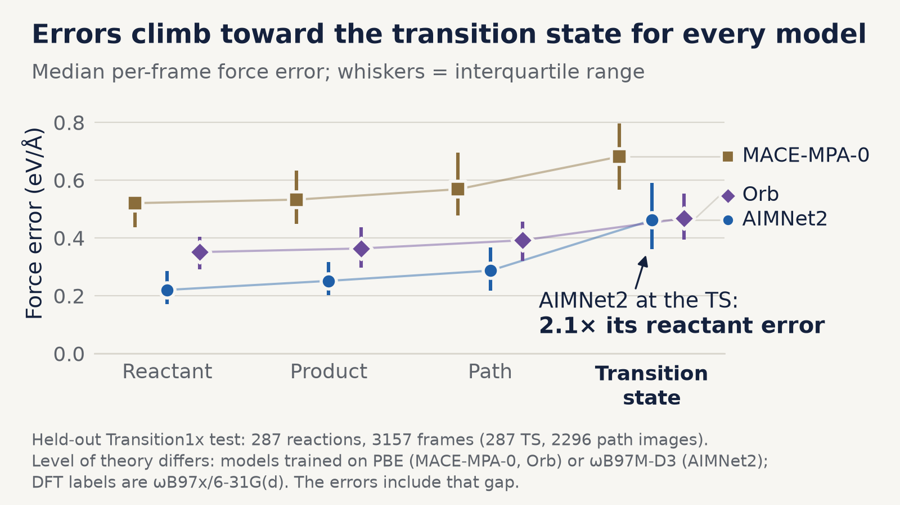
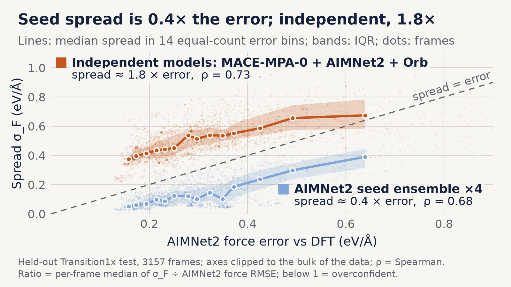
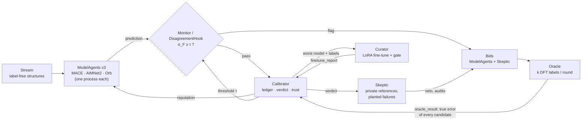
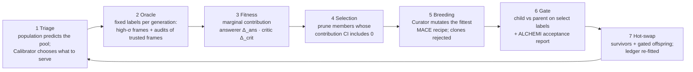
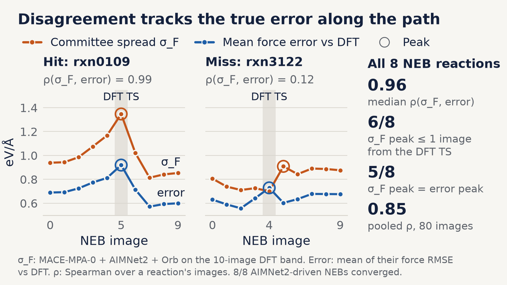
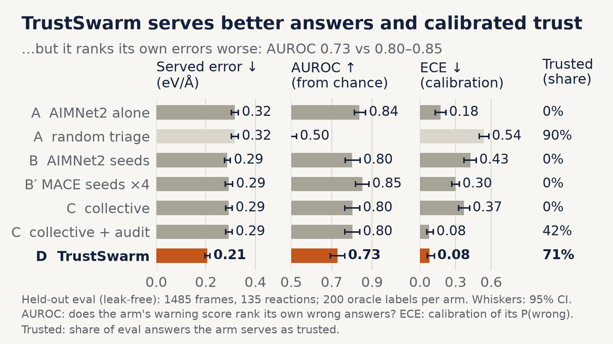
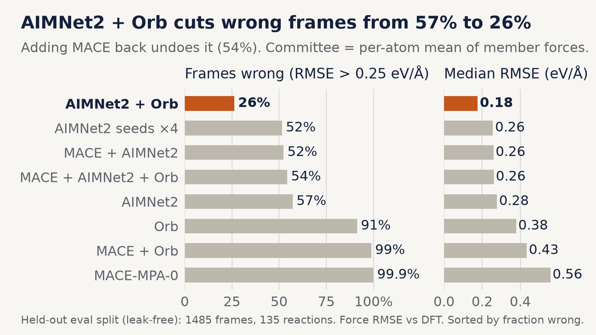
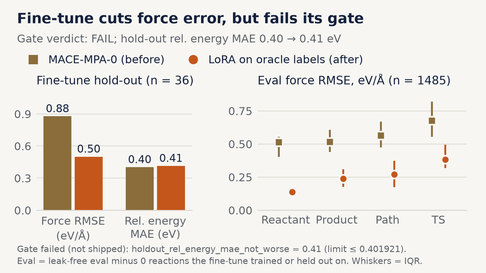

# Fittest

**A swarm of machine-learned interatomic potentials (MLIPs) that decides which model to trust on a
structure, where, and when to stop trusting any of them and call DFT.**

<!-- TODO(evolution): headline decided by results/evolution/SUMMARY.md.
     Keep "Survival of the fittest, in materials science" only if the swarm improved across >= 3
     generations at a fixed DFT budget with paired CIs. Otherwise keep the line above. -->

Built at ScienceClaw 2026 (MIT Media Lab) for the NVIDIA ALCHEMI challenge, on
[NVIDIA ALCHEMI Toolkit](https://github.com/NVIDIA/nvalchemi-toolkit) 0.3.0-rc.
Formerly **TrustSwarm**; the old GitHub URL redirects here.

* Code: this repo (`fittest/` package, MIT licence)
* Hosted MCP server: `https://fittest-mcp.westus2.cloudapp.azure.com/mcp`
* Authoritative numbers: [`results/RESULTS.md`](results/RESULTS.md) (generated from the result files)

---

## TL;DR

* **Problem.** Foundation MLIPs fail silently off-distribution. On held-out Transition1x reactions every
  model's force error rises toward the transition state; AIMNet2's median error at the TS is
  **2.1×** its error at the reactant.
* **Signal.** Disagreement between *independent* foundation models (MACE-MPA-0, AIMNet2, Orb-v3) tracks
  error without labels (Spearman **0.73**, 3,157 frames). Seed ensembles of one model do not measure
  error: their spread is **2.4–36×** smaller than the error of their mean.
* **Result (leak-free split, 200 DFT label lookups per arm).** The swarm serves better answers:
  force RMSE **0.206 eV/Å** vs 0.286–0.317 for every baseline, with calibrated trust (ECE **0.080**).
  The gain comes from *discovering* that averaging AIMNet2 and Orb is the best answer; a fixed
  AIMNet2+Orb average chosen in hindsight is as good (0.202).
* **Negative result.** The swarm ranks its own errors **worse** than the simple baselines:
  AUROC **0.73** vs 0.80–0.87. Its self-repair (LoRA fine-tune of MACE) halved force error on held-out
  labels but made relative energies worse, so its own gate refused to ship it.
* **Evolution.** TODO(evolution): one line from `results/evolution/SUMMARY.md` (generations, fixed DFT
  budget, paired CI vs the static control; improved / did not improve).
* **Use it now.** Add the hosted MCP server to Claude Code:
  `claude mcp add --transport http fittest https://fittest-mcp.westus2.cloudapp.azure.com/mcp`,
  then ask "should I trust an ML potential on this structure?". TODO(mcp): confirm against `docs/MCP.md`.

---

## Contents

1. [Use it now](#1-use-it-now) — MCP server, local install, Python API, ALCHEMI hook
2. [How it works](#2-how-it-works) — problem, signal, agents, blackboard, evolution, ALCHEMI usage
3. [Validation](#3-validation) — data, split, metrics, ablation, figures
4. [What failed and limitations](#4-what-failed-and-limitations)
5. [Reproduce](#5-reproduce)
6. [Repo map, privacy, licence, acknowledgements](#6-repo-map)

---

## 1. Use it now

### 1.1 Hosted MCP server (no install)

`fittest-mcp` exposes the swarm to any MCP client. It runs the three model agents
(MACE-MPA-0, AIMNet2, Orb-v3) as warm processes and turns their disagreement into a verdict
with the Calibrator state learned in the final run (`fittest/snapshots/trust_snapshot.json`,
identical to `results/trust_snapshot.json`).

| tool | input | returns |
|---|---|---|
| `check_structures` | XYZ text (single or multi-frame) and/or `{"Z"` or `"symbols", "R"}` objects, Å; ≤ 20 structures, ≤ 100 atoms each, non-periodic | per structure: `trust` / `send_to_dft`, trust score 0–1, recommended model or blend, served energy and force summary, σ_F vs τ, per-model summary, a `domain_warning` outside C/H/N/O and Transition1x sizes; `include_forces=true` for full force arrays |
| `explain` | one structure | σ_F vs τ, the Calibrator bucket and P(correct) of every candidate in it, which models disagree most, the most uncertain atoms |
| `swarm_status` | — | the population (answerers and the Skeptic critic) with reputations, calibration domain, threshold, live models, the evolution family tree if published |
| `usage_stats` | — | aggregate usage: distinct anonymous clients, calls per tool, first/last call |

TODO(mcp): verify every config below against `docs/MCP.md` when it lands.

**Claude Code**

```bash
claude mcp add --transport http fittest https://fittest-mcp.westus2.cloudapp.azure.com/mcp
```

**Cursor** (`~/.cursor/mcp.json`)

```json
{ "mcpServers": { "fittest": { "url": "https://fittest-mcp.westus2.cloudapp.azure.com/mcp" } } }
```

**Claude Desktop** (`claude_desktop_config.json`; runs the server locally over stdio; uses the real model agents only if they are installed in that environment, TODO(mcp): confirm fallback behaviour)

```json
{
  "mcpServers": {
    "fittest": {
      "command": "uvx",
      "args": ["--from", "git+https://github.com/Pavel-Tk/fittest", "fittest-mcp"]
    }
  }
}
```

Example prompt: *"Here is an XYZ of a C3H5NO2 transition-state guess. Use fittest to tell me
whether AIMNet2 can be trusted on it or whether I need DFT, and explain why."*

The verdict is calibrated on Transition1x C/H/N/O reaction chemistry. Outside that domain
(metals, charged species, periodic systems, water clusters) the trust numbers extrapolate and the
tool says so with `domain_warning`.

### 1.2 Local MCP server

```bash
uvx --from git+https://github.com/Pavel-Tk/fittest fittest-mcp                 # stdio; real models if installed
uvx --from git+https://github.com/Pavel-Tk/fittest fittest-mcp --fake-models   # CPU stand-ins, for wiring tests only
```

Real model agents need the `models` extra (ALCHEMI Toolkit with MACE and AIMNet2) and, for Orb, a
separate Python environment pointed to by `FITTEST_ORB_PYTHON` (orb-models pins dependencies that
conflict with the Toolkit). Local mode logs only to `~/.fittest-mcp` on your machine.

### 1.3 Python API: the trust service

```bash
git clone https://github.com/Pavel-Tk/fittest && cd fittest
uv venv .venv --python 3.11 && source .venv/bin/activate   # Windows: .venv\Scripts\activate
uv pip install -e ".[dev,service]"
```

```python
from fittest.service import TrustSnapshot, score, fake_predictors, connect_models

snap = TrustSnapshot.load("results/trust_snapshot.json")      # Calibrator state from the final run
# real model agents (one process each; GPU or CPU):
#   clients = connect_models(snap.models, base_port=6300, orb_python="/path/to/orb/env/python", device="cuda")
#   predictors = {m: c.predict for m, c in clients.items()}
predictors = fake_predictors(snap.models)                      # CPU stand-ins: wiring only, verdicts meaningless

water = {"Z": [8, 1, 1], "R": [[0, 0, 0], [0.96, 0, 0], [-0.24, 0.93, 0]]}
for r in score([water], predictors, snap):
    print(r["sigma_F"], r["flagged"], r["trust"], r["recommended_model"], r["action"])
# keys: sigma_F, sigma_F_max, mean_abs_fbar, flagged, trust, recommended_model, bucket,
#       action ("send to oracle / DFT" | "use <candidate>"), served_forces, served_members, per_model
```

HTTP and CLI wrappers of the same function:

```bash
python -m fittest.service serve --snapshot results/trust_snapshot.json --port 8000 [--fake-models]
curl -X POST localhost:8000/trust -H 'content-type: application/json' \
     -d '{"systems":[{"Z":[8,1,1],"R":[[0,0,0],[0.96,0,0],[-0.24,0.93,0]]}]}'
python -m fittest.service score my_molecules.xyz --snapshot results/trust_snapshot.json
```

`score` raises if a model agent the snapshot was learned with is missing: σ_F and its bins only
mean something for the committee that produced them.

### 1.4 The ALCHEMI hook: `DisagreementHook`

A drop-in Toolkit hook for any `FusedStage`, `FIRE2` or `NEB` run, with any committee of two or more
models. At admission and every `every` steps it asks every committee member for forces (one round
trip per model, concurrently), computes σ_F per system, and flags systems with σ_F ≥ τ. With
`graduate=True` a flagged system gets `status = exit_status`, leaves the batch at the next
`refill_check`, and the `SizeAwareSampler` refills its slot; the flagged system goes to your DFT queue.

```python
from nvalchemi.dynamics import FIRE2, ConvergenceHook, FusedStage, SizeAwareSampler
from nvalchemi.dynamics.base import DynamicsStage
from fittest import paths
from fittest.hook import DisagreementHook
from fittest.model_server import spawn
from fittest.models.mace_batched import BatchedMACE

committee = {m: spawn(m, 6100 + k, python=paths.model_python(m)).connect()   # one process per model agent
             for k, m in enumerate(["mace_mpa0", "aimnet2", "orb"])}
flagged = []
hook = DisagreementHook(committee, tau=0.57,          # eV/Å; float, or a zero-arg callable read at every check
                        every=10, stage="both",       # pristine geometry at admission + every 10 steps
                        graduate=True,                # flagged -> leaves the batch, sampler refills the slot
                        id_map=lambda sid: ds.load_order[sid],
                        on_flag=lambda rec: flagged.append(rec["key"]))

driver = BatchedMACE().model                          # any Toolkit BaseModelMixin drives the dynamics
relax = FIRE2(model=driver, dt=0.05, n_steps=50, convergence_hook=ConvergenceHook.from_fmax(0.05))
for h in driver.make_neighbor_hooks():
    relax.register_hook(h, stage=DynamicsStage.BEFORE_COMPUTE)
sampler = SizeAwareSampler(ds, max_atoms=1024, max_edges=None, max_batch_size=48)
fused = FusedStage(sub_stages=[(0, relax)], sampler=sampler, sinks=[], refill_frequency=1, hooks=[hook])
with fused:
    fused.run(batch=None, n_steps=20000)

hook.records[flagged[0]]   # sigma_admission, checks[{step, sigma, sigma_max, tau, energy}], at_flag{Z, R, forces}
hook.summary()             # n_flagged, round trips, gather time, dead models, failures
```

`ds` is any dataset that follows the Toolkit sampler protocol; a complete example is in
[`docs/REPRODUCE.md` §2](docs/REPRODUCE.md#2-use-the-disagreementhook-in-your-own-toolkit-run). For NEB use
`NEB(..., extra_hooks=[DisagreementHook(..., graduate=False)])`; without dynamics use
`fittest.hook.DisagreementMonitor(committee, tau).check(keys, Z, R, batch, step=0, phase="x")`.
Committee members can be `ModelClient`s, objects with `.predict(Z, R, batch[, charge])`, or plain
callables returning `(E, F)`. A member that raises or times out is logged and retired after
`max_failures` consecutive failures; checks continue while two members answer. To add your own model
as an agent, see [`docs/REPRODUCE.md` §3](docs/REPRODUCE.md#3-add-your-own-model-agent).

---

## 2. How it works

### 2.1 The problem: silent failures where reactions are decided

Labs spend months deciding whether a foundation MLIP is good enough for their chemistry. The models
return a number for every structure, with no warning when the structure is outside what they learned.
On the 3,157 held-out Transition1x test frames (287 reactions), median force RMSE against DFT
(ωB97x/6-31G(d)) rises from reactant to transition state for every model
([`results/fig/numbers.json`](results/fig/numbers.json), `fig1`):

| model | reactant | path | TS | TS / reactant |
|---|---|---|---|---|
| MACE-MPA-0 | 0.520 | 0.569 | 0.681 | 1.31× |
| AIMNet2 | 0.220 | 0.287 | 0.461 | **2.1×** |
| Orb-v3 (omat) | 0.351 | 0.392 | 0.468 | 1.33× |

(eV/Å, median per-frame force RMSE.)



### 2.2 The signal: disagreement between independent models

For M models predicting forces F_m on a structure with n atoms:

```
F̄_i  = mean_m F_m,i
s_i  = sqrt( mean_m ||F_m,i − F̄_i||² )      per-atom spread
σ_F  = mean_i s_i                            per-structure disagreement (eV/Å)
```

(`fittest.signals.force_spread`; the hook uses an identical vectorised twin, tested to agree.)

* Committee of independent models (MACE-MPA-0, AIMNet2, Orb): Spearman(σ_F, AIMNet2 force error)
  **0.73**; the spread is about **1.8×** the error.
* Seed ensemble (the four shipped AIMNet2 members): Spearman 0.68, but the spread is about **0.4×** the
  error — overconfident.
* On the 1,485 eval frames: the AIMNet2 ensemble's median error is **2.4×** its spread; four MACE LoRA
  seeds (arm B′) are **36×** under-dispersed (spread 0.008 eV/Å, error 0.278 eV/Å).

Seed ensembles can rank errors well while being badly under-dispersed: ranking and calibration are
different properties. This is why the swarm uses models trained on different data by different groups.



### 2.3 The agents and the blackboard

Each agent holds private information and talks to the others only through an append-only
**blackboard** (`fittest.blackboard.Blackboard`; the full arm-D log is
[`results/blackboard_armD.jsonl`](results/blackboard_armD.jsonl), 5,921 events). The round driver
advances the clock and makes no decisions; there is no central planner.

| agent | holds privately | decides | posts |
|---|---|---|---|
| **ModelAgent** ×3 (MACE-MPA-0, AIMNet2, Orb-v3) | its own weights (own OS process; Orb in its own Python env), its predictions, its oracle-revealed error history | how much to bid for a DFT label on each flagged system: `bid = rep · (1 − exp(−(σ + d_m) / 2 s_m))`, where `d_m` is its own deviation from the mean and `s_m` its learned error scale | `prediction`, `bid` |
| **Stream** (`PoolStream`) | the arrival schedule | nothing: a passive source of label-free structures | `system` |
| **Monitor** (`DisagreementMonitor`) | — | flag (σ_F ≥ τ) or pass; CPU twin of the ALCHEMI hook | `flag`, `pass` |
| **Oracle** | the DFT labels (Transition1x lookups), the budget | which bids get paid: exploration audits first, then the top-k summed bids per round | `oracle_result` (the only label channel) |
| **Skeptic** | held-out reference reactions (`skeptic_ref`) and planted known failures | vetoes a "trusted" verdict when its k=7 nearest references were wrong; plants known failures; spends 25% of each round's budget on random audits of *trusted* systems | `plant`, `veto`, `bid` |
| **Calibrator** | the ledger: per (candidate, context bucket) Beta posterior of correctness | what to serve (a single model or a subset mean, e.g. `mean(aimnet2+orb)`), the trust score, the threshold τ, reputations | `verdict`, `threshold`, `reputation` |
| **Curator** | fine-tune compute | which model to repair (highest ledger error) and whether the repair ships (all acceptance checks must pass) | `finetune_report` |



**What the Calibrator serves.** Candidates are every non-empty subset mean of the models (3 singletons,
3 pairs, the 3-way `consensus`). The context bucket is label-free: σ_F quantile bin (4) × mean |F̄| bin (3).
Per bucket it serves the candidate with the highest posterior probability of being correct. Its risk
score is an isotonic P(served answer wrong | feature); the feature (σ_F or the spread among the served
candidate's members) is chosen by 5-fold reaction-grouped CV on its own labels (it chose σ_F: CV AUROC
0.756 vs 0.752). τ = smallest σ with ledger P(wrong | σ ≥ τ) ≥ 0.5, floored at the round-0 70th
percentile of σ_F. In the final run τ stayed at that floor (0.620; see §4).

**What happened in the final run (arm D).** 200 oracle calls: 50 exploration audits and 150 won by
bids (9,745 bids placed). The hook flagged 601 systems; the Skeptic vetoed 1,788 trusted verdicts
(1,202 on pool systems; vetoes on eval are advisory). On eval the Calibrator served
`mean(aimnet2+orb)` on 1,373 of 1,485 frames and `aimnet2` on 112. Final reputations were nearly
equal (aimnet2 0.89, mace_mpa0 0.89, orb 0.89, skeptic 0.86).

### 2.4 The evolutionary layer

> TODO(evolution): status and outcome from `results/evolution/SUMMARY.md`. Mechanism below is from
> `fittest/evolution.py`; verify config values (labels per generation, population bounds, number of
> generations) against the SUMMARY.

The static swarm above has a fixed population. The evolutionary loop (`fittest/evolution.py`,
`scripts/evolve.py`) asks whether a population that breeds, selects and prunes its own members
improves at the **same DFT budget** as a static control. One generation:



* **Fitness = marginal contribution to the swarm**, measured only on oracle labels clean for every
  member (no member trained on that frame's endpoint-geometry component):
  * *answerer*: `Δ_ans(m) = err(P \ m) − err(P)`, where err is the mean served error in wrongness units
    (`F_RMSE / 0.25 + |ΔE_rel| / 0.25`) and the served answer comes from a Calibrator fitted out-of-fold
    (5-fold GroupKFold by reaction), so a member cannot look useful by overfitting the labels it is scored on;
  * *critic*: `Δ_crit(m) = AUROC(σ_F(P) → P wrong) − AUROC(σ_F(P \ m) → P\m wrong)`;
  * each Δ has a paired reaction-bootstrap SE and 95% CI; fitness = Δ_ans/SE_ans + Δ_crit/SE_crit; the role
    (answerer or critic) is the larger z-score.
* **Selection.** A member is eligible for pruning when neither Δ has a CI lower bound above 0 and its
  fitness is at or below a fixed cut; fitness is recomputed after every removal, so redundant twins are
  handled one at a time.
* **Breeding.** The Curator mutates the fine-tuning recipe of the fittest MACE-family members (energy:force
  loss weight, LoRA rank, learning rate, epochs, label subsample) and trains offspring on the *breed* half
  of the labels. A child whose force deviations correlate too strongly with an existing member is a clone
  and is rejected.
* **Gate.** On the *select* half (component-disjoint from every child's training labels, re-asserted) a
  child must be no worse than its parent on force RMSE and relative-energy MAE, and must pass the ALCHEMI
  acceptance report. Failing children are stillborn and kept in the family tree.
* **Eval never feeds back**: only the final scorer reads eval labels.

TODO(evolution): results table (generation, population, labels used, served F-RMSE eval, AUROC, paired CI vs
static control), family-tree figure, verdict sentence.

### 2.5 How the ALCHEMI Toolkit is used

| Toolkit feature (0.3.0-rc) | used for | evidence |
|---|---|---|
| In-flight batching: `FusedStage.run(batch=None)` + `SizeAwareSampler` + `FIRE2` | 600 Transition1x pool frames stream through a relaxation; flagged systems leave the batch and the sampler refills the slot | [`results/screen_alchemi.json`](results/screen_alchemi.json) |
| Hook protocol (`stage`, `frequency`, `__call__(ctx, stage)`, `ON_ADMISSION` / `AFTER_STEP`) | `DisagreementHook` gathers the committee's forces and graduates systems by setting `status = exit_status` | `fittest/hook.py`, `tests/test_hook.py` (7 tests on GPU, incl. a real `FusedStage` run) |
| `MACEWrapper`, AIMNet2 wrapper, `make_neighbor_hooks` | model agents and dynamics drivers | `fittest/models/`, `fittest/model_server.py` |
| Batched NEB (example 11 pattern), `extra_hooks` | 8 reactions × 10 images in one batch, with the hook observing (`graduate=False`) | [`results/neb.json`](results/neb.json) |
| `FineTuningStrategy` + `LoRAConfig`, `fit_atomic_reference_energies` | Curator's LoRA repair of MACE-MPA-0 on the oracle labels | `scripts/finetune.py`, `fittest/mace_lora.py` |
| `evaluate_accuracy` + `build_acceptance_report` | one of the Curator's ship/no-ship checks | `results/ablation.json` → arm D `finetune.report` |

**In-flight screen** (600 pool frames, MACE-MPA-0 driver, τ = 0.571 = 70th percentile of cached σ_F,
check every 10 steps, ≤ 50 FIRE2 steps per system, L4 GPU):

| | |
|---|---|
| flagged | 260 (180 at admission, 80 during relaxation) |
| converged / hit the step budget | 68 / 272 |
| refill events / systems admitted by refill | 202 / 552 |
| wall time, throughput | 131 s, 1,500 atom-steps/s; committee gather 42% of wall time |
| hook σ at admission vs offline σ | max \|Δ\| 2.8 × 10⁻⁶ eV/Å over 600 frames |
| post hoc: mean committee force RMSE | 0.549 eV/Å flagged vs 0.376 unflagged |

**Batched NEB** (8 reactions, AIMNet2 driver, climbing image, all 8 converged in 21 s): along the DFT
reference bands, σ_F follows force error (median per-reaction Spearman **0.96**, pooled 0.85; two reactions
at 0.12 and 0.16). σ_F does **not** track relative-energy error (median Spearman 0.14, pooled −0.20). The
maximum of σ_F is at the DFT transition state in 3/8 reactions and within one image of it in 6/8.



---

## 3. Validation

### 3.1 Data and split

* **Transition1x** (ωB97x/6-31G(d); C, H, N, O; neutral; ≤ 7 heavy atoms). 5,632 frames: reactant,
  product, TS and sampled NEB path images.
* The official Transition1x split is by chemical formula. Inside the test formulas, Transition1x reuses
  reactant geometries across reactions, so a per-reaction split leaks: it had **732** near-duplicate
  endpoint geometries between pool and eval. The final split groups reactions into connected components
  that share any reactant or product geometry (37 components, 287 reactions) and splits by component:
  **0** shared endpoint geometries and **0** near-duplicates (max |ΔR| < 10⁻³ Å) between pool and eval
  ([`results/split_report.json`](results/split_report.json)).

| split | source | frames | reactions | who sees labels |
|---|---|---|---|---|
| `pool` | T1x test | 1,672 | 152 | the Oracle, one paid call at a time |
| `eval` | T1x test | 1,485 | 135 | nobody during the run; final scoring only |
| `skeptic_ref` | T1x val | 1,221 | 111 | the Skeptic only |
| `planted` | T1x val | 1,254 | 114 | the Skeptic plants them; labels private |

Pool and eval still share chemical formulas.

* **Models and leakage.** MACE-MPA-0 (MPtrj + sAlex, PBE/PBE+U), AIMNet2 (ωB97M-D3, member 0 of the
  shipped ensemble), Orb `orb-v3-conservative-inf-omat` (OMat24, PBE/PBE+U). Orb models trained on OMol25
  were excluded: OMol25 recomputed Transition1x geometries. Details:
  [`docs/data_and_models.md`](docs/data_and_models.md).

### 3.2 Metrics, fixed before running

* **Wrong** ⇔ force RMSE > **0.25 eV/Å** or |ΔE_rel| > **0.25 eV** (relative to the reaction's reactant,
  so per-model reference energies cancel). Sensitivity at 0.15 and 0.4 is in `ablation.json` (`by_threshold`).
* **AUROC**: does the arm's warning score rank its own wrong served answers? Also against a common target
  (AIMNet2 wrong), since AIMNet2 is in every arm.
* **Recall@K**: share of wrong served answers that received an oracle call.
* **Planted caught**: share of planted known failures (AIMNet2 force RMSE > 0.4) flagged, vetoed or checked.
* **Served error** on eval (force RMSE, relative-energy MAE), **ECE** and **Brier** of the arm's P(wrong),
  **silent failures** (badly wrong, F-RMSE > 0.4, and trusted without a check), **trusted share**.
* 95% CIs: 1,000 bootstrap resamples over reactions, paired across arms.
* Budget: 200 Transition1x label lookups per arm (40 per round × 5 rounds).

### 3.3 Ablation (final run, v4)

| arm | models | warning score | served answer |
|---|---|---|---|
| A_single | AIMNet2 | max\|F\| | AIMNet2 |
| A_random | AIMNet2 | random | AIMNet2 |
| B_seed | AIMNet2 × 4 shipped seeds | seed σ_F | ensemble mean |
| B′ (B_mace_seeds) | MACE-MPA-0 × 4 LoRA seeds, fine-tuned on 160 of arm D's labels | seed σ_F | ensemble mean |
| C_collective | MACE + AIMNet2 + Orb | σ_F | ensemble mean |
| C_audit | C + the Skeptic's random audits of trusted systems | σ_F | ensemble mean |
| **D (Fittest)** | MACE + AIMNet2 + Orb + all agents | Calibrator risk / Skeptic | Calibrator's recommendation |

Arm D is labelled `D_trustswarm` in `results/ablation.json` (the pre-rename name).

| arm | AUROC eval | AUROC vs AIMNet2-wrong | Recall@K | planted caught | served F-RMSE eval (eV/Å) | served ΔE MAE eval (eV) | ECE eval | Brier eval | trusted share eval |
|---|---|---|---|---|---|---|---|---|---|
| A_single | 0.838 [0.81, 0.87] | 0.792 | 0.131 | 0.600 | 0.317 [0.30, 0.33] | 0.121 | 0.175 | 0.267 | 0.000 |
| A_random | 0.499 [0.47, 0.53] | 0.518 | 0.121 | 0.325 | 0.317 [0.30, 0.33] | 0.121 | 0.538 | 0.554 | 0.898 |
| B_seed | 0.802 [0.77, 0.84] | 0.802 | 0.166 | 0.700 | 0.286 [0.28, 0.30] | 0.110 | 0.426 | 0.428 | 0.000 |
| B′ MACE seeds | **0.867** [0.84, 0.90] | 0.483 | 0.157 | 0.500 | 0.304 [0.29, 0.32] | 0.493 | 0.263 | 0.267 | 0.000 |
| C_collective | 0.802 [0.77, 0.84] | **0.917** | 0.159 | 0.350 | 0.293 [0.28, 0.31] | 0.221 | 0.370 | 0.374 | 0.000 |
| C_audit | 0.802 [0.77, 0.84] | **0.917** | 0.138 | 0.375 | 0.293 [0.28, 0.31] | 0.221 | **0.079** | 0.189 | 0.419 |
| **D Fittest** | 0.730 [0.69, 0.76] | 0.738 | 0.186 | 0.450 | **0.206** [0.20, 0.22] | 0.151 | **0.080** | **0.185** | 0.708 |

Full table with every CI and the pool metrics: [`results/RESULTS.md`](results/RESULTS.md).

**Fittest (D) vs each baseline, paired 95% CI** (`better` / **worse**: the CI of the difference excludes 0):

| D vs | AUROC eval | Recall@K | planted | served F-RMSE | ECE | Brier | silent eval |
|---|---|---|---|---|---|---|---|
| A_single | **worse** | n.s. | n.s. | better | better | better | n.s. |
| A_random | better | better | n.s. | better | better | better | better |
| B_seed | **worse** | n.s. | n.s. | better | better | better | n.s. |
| B′ MACE seeds | **worse** | n.s. | n.s. | better | better | better | n.s. |
| C_collective | **worse** | n.s. | better | better | better | better | n.s. |
| C_audit | **worse** | n.s. | n.s. | better | n.s. | n.s. | n.s. |

**What is significant**

* Served answers: Fittest's force RMSE (0.206 eV/Å) is better than every baseline, and it is wrong on 40%
  of eval frames vs 54–73%. The gain is the *discovery* of `mean(aimnet2+orb)` from 200 labels; no
  baseline had subset candidates. A fixed AIMNet2+Orb average chosen in hindsight with eval labels scores
  0.202 eV/Å, i.e. as good. Budget sweep: 0.202 / 0.206 / 0.204 eV/Å at k = 20 / 40 / 80 labels per round.
* Calibration: ECE 0.080 and Brier 0.185, better than A_single, A_random, B, B′ and C; tied with C_audit.
  The calibration gain comes from the Skeptic's random audits of trusted answers.

**What is not**

* Error ranking: Fittest's AUROC (0.730) is significantly **worse** than A_single, B, B′, C and C_audit.
* Silent failures: Fittest has 0/96 on eval and 1/115 on pool, not significantly different from the five
  non-random baselines — four of which trust nothing and have zero by construction.
* Planted failures: 0.45 caught vs 0.33–0.70; better than C_collective only.



**Why averaging AIMNet2 and Orb helps** (eval, force-only wrongness at 0.25 eV/Å): AIMNet2 alone is wrong
on 57.2% of frames, the AIMNet2+Orb mean on 26.3%; adding MACE undoes it (54.3%); the AIMNet2 seed mean
reaches 51.6%.



### 3.4 Self-repair (Curator)

The Curator chose `mace_mpa0` (highest ledger force RMSE, 0.80 eV/Å vs 0.51 Orb and 0.43 AIMNet2) and
handed over 186 oracle labels; the GPU job trained a LoRA adapter on 160 and held out 26 (3 whole
geometry components, 0 shared geometries with training).

| check (all must pass) | source | value | limit | result |
|---|---|---|---|---|
| hold-out force RMSE not worse | Fittest | 1.355 → 0.692 eV/Å | ≤ base | pass |
| hold-out relative-energy MAE not worse | Fittest | 0.314 → 0.364 eV | ≤ base | **fail** |
| worst error ratio vs equal-size from-scratch student | ALCHEMI `build_acceptance_report` | 1.404 | ≤ 1.0 | **fail** |
| ALCHEMI report accepted | ALCHEMI | false | true | **fail** |

Not shipped. The unshipped adapter's median force RMSE on eval would have been 0.279 vs 0.558 eV/Å for the
base model (figure only; never served).



---

## 4. What failed and limitations

Everything below is also in [`results/RESULTS.md`](results/RESULTS.md) ("Failures and caveats").

* **Error ranking is worse.** AUROC 0.730 vs 0.80–0.87 for the simple baselines. Arm D's risk score is
  learned from bid-won labels, which are concentrated at high σ.
* **Selection bias in the labels.** In v1 the oracle labelled only flagged (high-σ) systems, so trust was
  never tested where it was given. v2 added the Skeptic's random audits of trusted systems (25% of each
  round's budget); they reduce but do not remove the bias.
* **Leaks, found and fixed.** v1–v2 split by reaction; Transition1x reuses reactant geometries, so pool and
  eval shared 732 near-duplicate endpoints. v3 splits by geometry component (0 shared). The Curator's first
  hold-out was also leaky (9 hold-out reactions each shared an endpoint with training) and was replaced by
  whole components. v1's planted cases were defined as "MACE wrong", which favoured arms containing MACE;
  v2 onward uses "AIMNet2 badly wrong".
* **Repair blocked by its own gate.** Forces improved 1.355 → 0.692 eV/Å, relative energies got worse
  (0.314 → 0.364 eV), and the ALCHEMI from-scratch ratio was 1.404 > 1.0.
* **τ never moved.** The Calibrator's threshold stayed at its round-0 floor (0.620) for all rounds: flags
  came from the 70th-percentile rule, not from learning.
* **Reputations barely differentiated** (0.86–0.89): reputation-weighted bidding behaved like summed bids.
* **The served-answer gain equals a hindsight choice** (0.202 vs 0.206 eV/Å). Which candidate each budget
  in the sweep recommended is not recorded.
* **Level of theory.** MACE-MPA-0 and Orb-v3-omat are PBE materials models, AIMNet2 is ωB97M-D3, labels
  are ωB97x/6-31G(d). Absolute energies are never compared across models; part of every error is the
  level-of-theory gap, not model failure.
* **Labels are lookups, not live DFT.** The Oracle reveals stored Transition1x labels.
* **The ablation is a CPU replay of GPU predictions.** Agents replay predictions cached by the model-agent
  processes on the GPU, and the hook's logic runs as its CPU twin (`DisagreementMonitor`). The ALCHEMI hook
  itself runs in the 600-frame in-flight screen and in NEB; the ablation does not consume that screen's
  oracle queue.
* **Narrow calibration domain.** Trust numbers are learned on C/H/N/O reaction chemistry with ≤ 7 heavy
  atoms. On water, metals, charged or periodic systems they extrapolate.
* **Evolution.** TODO(evolution): failures/limits reported in `results/evolution/SUMMARY.md`.
* The synthetic smoke test (`scripts/make_synthetic.py`) shows the pipeline runs; it is not evidence.

---

## 5. Reproduce

### 5.1 CPU, from a fresh clone (minutes)

```bash
git clone https://github.com/Pavel-Tk/fittest && cd fittest
uv venv .venv --python 3.11 && source .venv/bin/activate
uv pip install -e ".[dev,service]"
pytest                                  # CPU suite; GPU-only hook tests skip
python scripts/make_synthetic.py        # synthetic frames + predictions
python scripts/run_ablation.py --frames data/synthetic/frames.pkl --preds data/synthetic/preds --out results/synthetic
python -m fittest.service serve --snapshot results/trust_snapshot.json --fake-models --port 8000
```

**CPU VM with the real model agents** (what the hosted MCP server runs: Ubuntu 24.04, 8 vCPU, no GPU):

```bash
bash scripts/setup_cpu.sh [WORKDIR]     # core env (CPU torch + ALCHEMI Toolkit 0.3.0-rc + MACE + AIMNet2) and an Orb env
```

The cached predictions (`data/frames.pkl`, `data/preds/`, `data/ckpt/`, 23 MB) are gitignored; copy them from
a machine that ran step 1 below. Every CPU result step (2, 5, 7, figures, RESULTS.md) then runs without a GPU.

### 5.2 GPU (Colab L4), every result file

```bash
bash scripts/setup_gpu.sh ..            # toolkit 0.3.0-rc (cu13) + core env, Orb env, Transition1x (6.6 GB, md5-checked)
```

| step | command | writes | L4 time |
|---|---|---|---|
| 1 frames + predictions | `python scripts/predict_pool.py --build-frames --models aimnet2,aimnet2_m0,aimnet2_m1,aimnet2_m2,aimnet2_m3,orb,mace_mpa0 --base-port 6000` | `data/frames.pkl`, `data/preds/*.npz`, `results/predict_status.json` | ~2.5 min |
| 2 signal | `python scripts/analyze_signal.py --frames data/frames.pkl --preds data/preds` | `results/signal.{json,png}` | seconds (CPU) |
| 3 in-flight screen | `python scripts/screen_alchemi.py --split pool --max-frames 600 --every 10 --n-steps 50 --score-labels --base-port 6100` | `results/screen_alchemi.json` | 131 s + ~60 s server start |
| 4 batched NEB | `python scripts/run_neb.py --driver aimnet2 --base-port 6103` | `results/neb.json`, `results/neb_sigma.png` | 21 s + ~60 s |
| 5 ablation | `python scripts/run_ablation.py --frames data/frames.pkl --preds data/preds --out results/ --budget-per-round 40 --rounds 5 --seed 0 --budgets 20,40,80` | `results/ablation*.{json,png}`, `blackboard_armD.jsonl`, `trust_snapshot.json`, `oracle_labels_armD.json` | ~12 s (CPU) |
| 6 Curator repair | `python scripts/finetune.py --frames data/frames.pkl --labelled-uids results/oracle_labels_armD.json --model mace_mpa0 --out data/preds/mace_lora_curated.npz --ckpt data/ckpt/mace_lora_curated --epochs 40 --seed 0 --predict-uids all` | `data/preds/mace_lora_curated.npz`, `data/ckpt/mace_lora_curated/acceptance_report.json` | ~2 min |
| 6′ B′ seeds | step 6 with `--seeds 0,1,2,3` | `data/preds/mace_seed{0..3}.npz` | ~6 min |
| 7 ablation again | step 5 (arm D replays the fine-tune; B′ uses the seeds) | `results/ablation.*` | ~12 s |
| 8 report + figures | `python scripts/write_results.py && python scripts/make_figures.py` | `results/RESULTS.md`, `results/fig/*` | seconds |
| 9 service demo | `python scripts/demo_service.py --snapshot results/trust_snapshot.json` | `results/service_demo.json` | ~1 min |
| 10 evolution | TODO(evolution): exact `scripts/evolve.py` command from SUMMARY | `results/evolution/` | TODO |

The arm-D label set is md5-pinned (`ad5f14229a51679267d4fd9456feb589`, `docs/STATUS_core.md`); the v3 and v4
reporting changes did not alter it. Environment variables (`FITTEST_T1X`, `FITTEST_CORE_PYTHON`,
`FITTEST_ORB_PYTHON`, `FITTEST_NEB_DIR`, `FITTEST_LOG_DIR`) and per-step details: [`docs/REPRODUCE.md`](docs/REPRODUCE.md).

---

## 6. Repo map

```
fittest/
  agents/           ModelAgent, Oracle, Skeptic, Calibrator, Curator, PoolStream, DisagreementMonitor
  blackboard.py     append-only event log (JSONL audit trail)
  signals.py        σ_F, errors, wrongness
  candidates.py     subset-mean candidates the Calibrator can serve
  hook.py           DisagreementHook (ALCHEMI Toolkit) + toolkit-agnostic DisagreementMonitor
  model_server.py   one process per model agent (own Python env if needed) + client
  models/           Toolkit wrappers (batched MACE, AIMNet2 calculator, I/O)
  mace_lora.py      LoRA checkpoint format + loader
  ablation.py       arms, metrics, paired bootstrap
  round_driver.py   the clock
  service.py        trust service: score(), FastAPI app, CLI
  mcp_server.py     fittest-mcp (MCP tools: check_structures, explain, swarm_status, usage_stats)
  usage_log.py      privacy-preserving usage log of the MCP server
  evolution.py      evolutionary loop (fitness, selection, breeding, gate)
  snapshots/        packaged Calibrator snapshot used by the MCP server
scripts/            GPU and CPU job scripts (see §5), setup_gpu.sh, setup_cpu.sh
results/            every number in this README; RESULTS.md; fig/; earlier versions v1–v3
docs/               DESIGN.md (contract), REPRODUCE.md, alchemi_api_notes.md, data_and_models.md, MCP.md
tests/              CPU pytest suite (synthetic data; no GPU or Transition1x needed)
```

TODO(mcp): add `deploy/` once it lands.

### Privacy: what the hosted MCP server logs

Every call is logged as one SQLite row (`fittest/usage_log.py`): UTC time, tool name, transport, an
anonymous client id (HMAC-SHA256 of client name, client version and remote IP under a server-side secret
salt, truncated to 16 hex characters; raw IPs are never written), structure count, total atom count,
verdict counts, latency, ok/error and the exception *type* (never its message). **Structures, coordinates
and names are not stored.** Aggregate counts are public at `/stats` and through the `usage_stats` tool. Local (stdio) mode logs only on your machine.
TODO(mcp): confirm against `docs/MCP.md` (retention, `/stats` URL).

### Licence

MIT ([`LICENSE`](LICENSE)). Model weights and datasets keep their own licences.

### Acknowledgements and references

* **NVIDIA ALCHEMI Toolkit** 0.3.0-rc — in-flight batching, hooks, batched NEB, LoRA fine-tuning and
  acceptance reports. <https://github.com/NVIDIA/nvalchemi-toolkit>
* **Transition1x** — M. Schreiner, A. Bhowmik, T. Vegge, J. Busk, O. Winther, "Transition1x – a dataset for
  building generalizable reactive machine learning potentials", *Sci. Data* **9**, 779 (2022).
  doi:[10.1038/s41597-022-01870-w](https://doi.org/10.1038/s41597-022-01870-w)
* **MACE / MACE-MP** — I. Batatia et al., "A foundation model for atomistic materials chemistry",
  arXiv:[2401.00096](https://arxiv.org/abs/2401.00096); I. Batatia, D. P. Kovács, G. N. C. Simm, C. Ortner,
  G. Csányi, "MACE: Higher order equivariant message passing neural networks for fast and accurate force
  fields", NeurIPS 2022. Checkpoint `medium-mpa-0`.
* **AIMNet2** — D. M. Anstine, R. Zubatyuk, O. Isayev, "AIMNet2: a neural network potential to meet your
  neutral, charged, organic, and elemental-organic needs", *Chem. Sci.* (2025).
  doi:[10.1039/D4SC08572H](https://doi.org/10.1039/D4SC08572H)
* **Orb-v3** — B. Rhodes et al., "Orb-v3: atomistic simulation at scale",
  arXiv:[2504.06231](https://arxiv.org/abs/2504.06231). Checkpoint `orb-v3-conservative-inf-omat`.
* **LoRA** — E. J. Hu et al., "LoRA: Low-rank adaptation of large language models",
  arXiv:[2106.09685](https://arxiv.org/abs/2106.09685).
* Closest prior art on heterogeneous committees of foundation MLIPs: Y. Liu et al., "Heterogeneous ensemble
  enables a universal uncertainty metric for atomistic foundation models",
  arXiv:[2507.21297](https://arxiv.org/abs/2507.21297). Query-by-committee active learning: J. S. Smith et
  al., *J. Chem. Phys.* **148**, 241733 (2018). More in [`docs/data_and_models.md`](docs/data_and_models.md).
