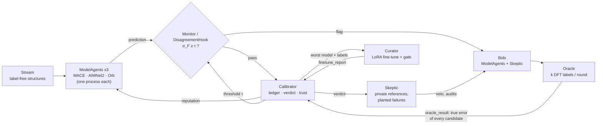
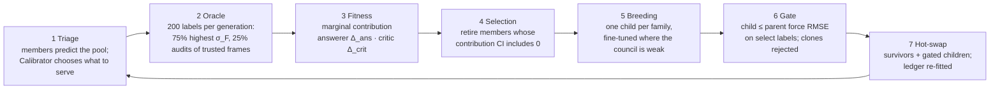

# Fittest

**The fittest survive, not the smartest.** An evolving agent council that decides what gets compute and lab
time.

Intelligence is abundant; ground truth is not. ML models screen candidate molecules and materials by the
million, but only a few get a high-fidelity calculation (DFT) or a lab experiment. Fittest is a council of
three independent foundation machine-learned interatomic potentials (MLIPs: MACE-MPA-0, AIMNet2, Orb-v3) and
four role agents (Skeptic, Calibrator, Oracle, Curator) that share one log. For every structure it decides
which answer to serve, how far to trust it, and which structures get ground truth. In this repo ground truth
is DFT read from Transition1x (lookups, not live calculations); the decision is the same for lab time.

The project asks two questions, each tested against baselines or a pre-registered rule:

1. **What if the models decide as a council?** Their disagreement tells the council when to be skeptical
   ([§2.3](#23-idea-1-decide-as-a-council), [§3.3](#33-ablation-idea-1-final-run-v4)).
2. **Can the council evolve to give better predictions?** Yes, once the test for new members was fixed:
   fine-tuned children replace their parents ([§2.5](#25-idea-2-let-the-council-evolve)).

Built at ScienceClaw 2026 (MIT Media Lab) for the NVIDIA ALCHEMI challenge, on
[NVIDIA ALCHEMI Toolkit](https://github.com/NVIDIA/nvalchemi-toolkit) 0.3.0-rc.
Formerly **TrustSwarm**; the old GitHub URL redirects here.

* Code: this repo (`fittest/` package, MIT licence)
* Hosted MCP server: `https://fittest-mcp.westus2.cloudapp.azure.com/mcp`
* Authoritative numbers, all generated from the result files: [`results/RESULTS.md`](results/RESULTS.md)
  (Idea 1), [`results/evolution/SUMMARY.md`](results/evolution/SUMMARY.md) (Idea 2) and
  [`results/story_numbers.json`](results/story_numbers.json) (`scripts/story_numbers.py`: the critic values,
  run F's lineages and its absolute errors)

---

## TL;DR

* **Problem: the best model fails silently where it matters.** On 287 held-out Transition1x reactions every
  model's force error peaks at the transition state, the top of the energy hill that sets the reaction rate.
  AIMNet2 leads at the reactant (median 0.22 vs 0.35 eV/Å for Orb) and loses its lead at the transition
  state (0.46 vs 0.47), with no warning. Its own seed ensemble does not warn either: its spread is 2.4×
  smaller than its error.
* **The council: each decision has an owner, no central planner.** Three models answer independently and
  never see each other's answers. The Calibrator keeps the track record and chooses what to serve, the
  Skeptic audits trusted answers at random and vetoes, the Oracle spends the ground-truth budget, and the
  Curator breeds and retires members. They coordinate only through an append-only log, so every decision
  replays. The agents are deterministic programs, not LLMs; an LLM agent uses the whole council as one tool
  (MCP).
* **Idea 1: decide as a council** (leak-free split, 200 DFT label lookups per arm).
  * Disagreement between independent models flags when the best model is wrong, with no labels:
    AUROC **0.917** against "AIMNet2 wrong" (pool split, 1,672 frames). Copies of one model are
    overconfident: their spread is 2.4–36× smaller than their error.
  * Served force RMSE **0.206 eV/Å** vs 0.286 for the best baseline (**−28%**). The council discovered from
    200 labels that averaging AIMNet2 and Orb is the best answer; that average, picked in hindsight with eval
    labels, is as good (0.202).
  * Adding one role, the Skeptic's random audits of trusted answers, cuts calibration error (ECE) from
    0.370 to 0.079 (**4.6×**).
  * Negative: the council's own risk score ranks its remaining errors worse than the simple baselines
    (AUROC 0.73 vs 0.80–0.87).
* **The worst model is the best critic.** As an answerer MACE-MPA-0 is wrong on 99.9% of eval frames
  (Orb 91.3%, AIMNet2 57.2%). As a critic it is the only foundation model whose removal makes the council
  worse at spotting mistakes: mean ΔAUROC **+0.040** over 491 fitness checks (AIMNet2 −0.067, Orb −0.037).
* **Idea 2: let the council evolve** (pre-registered, failures included). The Curator breeds fine-tuned
  children on the labels the council already paid for; a child must beat its parent on labels it never
  trained on, and members that add nothing are retired. The first four designs (runs A–D) failed their rule
  or were not confirmed. A diagnosis showed why: the test's energy check on a few labels was noise and threw
  out the best children. With a force-only test (**run F**, 12 new seeds, 800 lookups for both arms) the
  evolving council beats the static council in **12 of 12 seeds**: −0.026 eV/Å [−0.030, −0.021] (−12%), and
  **−14%** on 2,475 structures from new chemical formulas that no run had read. In total that is **0.181 vs
  0.286 eV/Å** against the best Idea 1 baseline on the same eval frames (**−37%**), and below the hindsight
  average. 108 children were bred, 43 sit in the final councils, and 32 of the 36 foundation models were
  retired. Caveat: growing the council without selection (run E) already gives −0.018 of the −0.026;
  selection's own share is not isolated yet.
* **Use it now.** Add the hosted MCP server to Claude Code:
  `claude mcp add --transport http fittest https://fittest-mcp.westus2.cloudapp.azure.com/mcp`,
  then ask *"Use fittest to check whether I can trust an ML potential on this water molecule: O 0 0 0,
  H 0.96 0 0, H -0.24 0.93 0."* Structures are never stored ([logging policy](#privacy-what-the-hosted-mcp-server-logs)).

---

## Contents

1. [Use it now](#1-use-it-now) — MCP server, local install, Python API, ALCHEMI hook
2. [How it works](#2-how-it-works) — the problem, the council, Idea 1, the worst model as critic, Idea 2
   (evolution), ALCHEMI usage
3. [Validation](#3-validation) — data, split, metrics, the Idea 1 ablation, self-repair
4. [What failed and limitations](#4-what-failed-and-limitations) — and next steps
5. [Reproduce](#5-reproduce)
6. [Repo map, privacy, licence, acknowledgements](#6-repo-map)

---

## 1. Use it now

### 1.1 Hosted MCP server (no install)

`fittest-mcp` exposes the council to any MCP client over streamable HTTP. The three model agents
(MACE-MPA-0, AIMNet2, Orb-v3) run as warm CPU processes on an Azure VM, and their disagreement is
turned into a verdict with the Calibrator state learned in the final run
(`fittest/snapshots/trust_snapshot.json`, identical to `results/trust_snapshot.json`). Landing page:
<https://fittest-mcp.westus2.cloudapp.azure.com/>, public counts at
[`/stats`](https://fittest-mcp.westus2.cloudapp.azure.com/stats), health at
[`/health`](https://fittest-mcp.westus2.cloudapp.azure.com/health). Full guide: [`docs/MCP.md`](docs/MCP.md).

| tool | input | returns |
|---|---|---|
| `check_structures` | `structures`: XYZ text (single or multi-frame; bare atoms on lines or separated by `,`/`;`), one `{Z or symbols, R}` object, or a list mixing both (Å); `include_forces` (default false) | per structure: `verdict` (`trust` / `send_to_dft`) and `verdict_reasons`; `trust_score` with `trust_score_90ci` and `labels_behind_score`; `recommended` model or blend and its `served_members`; `served_energy_eV` and `reference_energy_eV` (one fixed model, AIMNet2, for the whole batch); max/mean force (eV/Å); `sigma_F` vs `tau`; per-model energy and max force; `domain_warning`. A structure that cannot be parsed gets its own `{index, error}` entry and the rest of the batch is still scored |
| `explain` | one structure | the same verdict, by the same rule, with the reason in words; σ_F vs τ; the Calibrator bucket (σ_F range, mean-force range, oracle labels in it) and the posterior P(correct) with interval for every candidate in it; each member's deviation from the committee mean; pairwise force RMS; the most divergent member; the three most uncertain atoms |
| `swarm_status` | none | answerers (MACE-MPA-0, AIMNet2, Orb-v3, live status, reputation), critic (Skeptic), coordinators (Calibrator, Oracle, Curator); the ledger; the calibration domain, τ, the verdict rule and the supported elements; the evolution family trees of runs A, B and C (`family_tree.json` in `results/evolution/`, `results/evolution_aimnet/` and each `results/evolution_c/<budget>/`) |
| `usage_stats` | none | users ([definition](#privacy-what-the-hosted-mcp-server-logs)), total / external / internal calls, calls per tool, first and last call |

Limits: ≤ 20 structures per call, ≤ 100 atoms each, non-periodic, coordinates within ±1000 Å, no atoms
closer than 0.3 Å; element symbols must be exact (`Cl` or `cl`; PDB-style `C1` is fine, ambiguous `CA` or
`HE1` is an error); per-client rate limit (burst 20, then 1 call per 2 s) plus a per-IP limit; 120 s per
request; model evaluations are serialized.

**The verdict rule.** One rule feeds `check_structures`, `explain` and the usage counts. A structure gets
`trust` only if all four hold:

1. every model agent supports its elements (AIMNet2 sets the limit; the full committee covers
   H B C N O F Si P S Cl As Se Br I), otherwise `send_to_dft` with reason `unsupported_elements` and no
   trust score;
2. the forces do not all vanish (max |F| < 0.05 eV/Å for every model means symmetry or exact equilibrium,
   where disagreement carries no information);
3. σ_F < τ;
4. `trust_score` ≥ 0.5.

Otherwise the verdict is `send_to_dft`, with every failing condition listed in `verdict_reasons`.
τ = 0.620 eV/Å is fixed: it is the 70th percentile of σ_F on the round-0 pool, which the Calibrator's
threshold rule never moved. `trust_score` is the Calibrator's Beta posterior mean of P(served answer
correct) for the served candidate in the structure's (σ_F, mean |F|) bucket, built from DFT oracle labels
on Transition1x with prior Beta(2, 1), so it is never exactly 1. It comes with `trust_score_90ci` (the
90% credible interval) and `labels_behind_score` (the DFT labels in that bucket); a bucket with few labels
gives a wide interval, so read the score with it. "Correct" means force RMSE ≤ 0.25 eV/Å and relative
energy error ≤ 0.25 eV (relative to the reaction's reactant). The ECE 0.080 in §3.3 is for arm D's risk score
(max of the isotonic P(served wrong) and the Skeptic's p_S); the calibration of this per-bucket `trust_score`
has not been measured beyond the 12-frame spot check below.

**Claude Code**

```bash
claude mcp add --transport http fittest https://fittest-mcp.westus2.cloudapp.azure.com/mcp
```

**Cursor** (`~/.cursor/mcp.json`)

```json
{ "mcpServers": { "fittest": { "url": "https://fittest-mcp.westus2.cloudapp.azure.com/mcp" } } }
```

**Claude Desktop / claude.ai**: Settings → Connectors → Add custom connector →
`https://fittest-mcp.westus2.cloudapp.azure.com/mcp`.

Example prompt: *"Use fittest to check whether I can trust an ML potential on this water molecule:
O 0 0 0, H 0.96 0 0, H -0.24 0.93 0."* Atoms may be separated by newlines, commas or semicolons. In
the Round-2 verification run this prompt, used verbatim, gave `trust`, trust score 0.857 (90% CI
0.61–0.99, 4 labels behind it), recommended AIMNet2, σ_F = 0.378 eV/Å below τ = 0.620 eV/Å
([`docs/MCP.md`](docs/MCP.md), verification log).

**Hosted CPU vs the GPU run.** On the 12 held-out Transition1x frames of `results/service_demo.xyz` the
hosted server's σ_F ≥ τ flags agree 12/12 with the earlier GPU run (`results/service_demo.json`), with
max |Δσ_F| = 0.0005 eV/Å. Under the verdict rule 7 of the 12 are trusted and none of the trusted frames is
DFT-wrong; the earlier τ-only rule trusted 2 DFT-wrong frames.

**Domain.** The Calibrator learned from gas-phase C/H/N/O Transition1x reactions with at most 7 heavy atoms,
including transition states and NEB paths. A `domain_warning` is added for elements outside C/H/N/O that
the committee still supports, larger molecules, isolated atoms or fragments and unusually short bonds;
there the trust score is an extrapolation. Absolute energies are on each model's own reference (PBE for
MACE and Orb, ωB97M for AIMNet2), so `served_energy_eV` values from different models are not comparable
and a batch whose served model differs carries an `energy_warning`. Compare `reference_energy_eV`
(always AIMNet2) across structures instead.

### 1.2 Local MCP server

```bash
# demo only: a plain uvx install has no model agents
claude mcp add fittest-demo -- uvx --from git+https://github.com/Pavel-Tk/fittest fittest-mcp --fake-models

# real models: install into an environment that has them (documented, not yet tested end to end)
uv venv fittest-env --python 3.12
uv pip install --python fittest-env/bin/python "fittest[models] @ git+https://github.com/Pavel-Tk/fittest" \
    --extra-index-url https://download.pytorch.org/whl/cpu --index-strategy unsafe-best-match   # CPU torch
# optional: Orb-v3 in its own env (orb-models conflicts with the Toolkit), as in scripts/setup_cpu.sh
uv venv orb-env --python 3.12
uv pip install --python orb-env/bin/python torch --index-url https://download.pytorch.org/whl/cpu
uv pip install --python orb-env/bin/python "dm-tree>=0.1.9" orb-models ase numpy \
    --extra-index-url https://download.pytorch.org/whl/cpu --index-strategy unsafe-best-match
# then register ONE of these two (same name, alternatives):
claude mcp add fittest-local -- $PWD/fittest-env/bin/fittest-mcp          # (a) MACE + AIMNet2 only
claude mcp add fittest-local -e FITTEST_ORB_PYTHON=$PWD/orb-env/bin/python -- $PWD/fittest-env/bin/fittest-mcp   # (b) full committee
```

A plain `uvx --from git+…` install has **no model agents**. It serves only `--fake-models`, CPU stand-ins
whose verdicts mean nothing (useful to test the wiring); without that flag the tools return an error
pointing to `--fake-models`, the `[models]` extra and the hosted server. For real verdicts, install into an
environment that has the models and point your client at that environment's `fittest-mcp`. **This
real-models local install is documented but has not been tested end to end** (fresh environment through to
a verdict); the hosted server is the tested path.

The `[models]` extra installs MACE-MPA-0 and AIMNet2 through the ALCHEMI Toolkit. Orb-v3 needs its own
Python environment because orb-models pins dependencies that conflict with the Toolkit; set
`FITTEST_ORB_PYTHON` to that environment's Python. With only MACE and AIMNet2 the server serves a
**partial committee** and every response carries a warning: τ and the Calibrator's buckets and ledger were
built on the full three-model committee, so verdicts are approximate. Local mode runs over stdio on CPU:
the commands above install CPU-only torch. `--device cuda` needs CUDA builds of torch in both
environments instead (install without the CPU index, as `scripts/setup_gpu.sh` does). It spawns one process per installed model agent, each with its own random
socket key, logs only to `~/.fittest-mcp/usage.sqlite` and never reports anywhere.

### 1.3 Python API: the trust service

```bash
git clone https://github.com/Pavel-Tk/fittest && cd fittest
uv venv .venv --python 3.11 && source .venv/bin/activate   # Windows: .venv\Scripts\activate
uv pip install -e ".[dev,service]"
```

```python
from fittest.service import TrustSnapshot, score, fake_predictors, connect_models

snap = TrustSnapshot.load("results/trust_snapshot.json")      # Calibrator state from the final run
# real model agents (one process each; GPU or CPU):
#   clients = connect_models(snap.models, base_port=6300, orb_python="/path/to/orb/env/python", device="cuda")
#   predictors = {m: c.predict for m, c in clients.items()}
predictors = fake_predictors(snap.models)                      # CPU stand-ins: wiring only, verdicts meaningless

water = {"Z": [8, 1, 1], "R": [[0, 0, 0], [0.96, 0, 0], [-0.24, 0.93, 0]]}
for r in score([water], predictors, snap):
    print(r["sigma_F"], r["flagged"], r["trust"], r["recommended_model"], r["action"])
# keys: sigma_F, sigma_F_max, mean_abs_fbar, flagged, trust, recommended_model, bucket,
#       action ("send to oracle / DFT" | "use <candidate>"), served_forces, served_members, per_model
```

HTTP and CLI wrappers of the same function:

```bash
python -m fittest.service serve --snapshot results/trust_snapshot.json --port 8000 [--fake-models]
curl -X POST localhost:8000/trust -H 'content-type: application/json' \
     -d '{"systems":[{"Z":[8,1,1],"R":[[0,0,0],[0.96,0,0],[-0.24,0.93,0]]}]}'
python -m fittest.service score my_molecules.xyz --snapshot results/trust_snapshot.json
```

`score` raises if a model agent the snapshot was learned with is missing: σ_F and its bins only
mean something for the committee that produced them.

### 1.4 The ALCHEMI hook: `DisagreementHook`

A drop-in Toolkit hook for any `FusedStage`, `FIRE2` or `NEB` run, with any committee of two or more
models. At admission and every `every` steps it asks every committee member for forces (one round
trip per model, concurrently), computes σ_F per system, and flags systems with σ_F ≥ τ. With
`graduate=True` a flagged system gets `status = exit_status`, leaves the batch at the next
`refill_check`, and the `SizeAwareSampler` refills its slot; the flagged system goes to your DFT queue.

```python
from nvalchemi.dynamics import FIRE2, ConvergenceHook, FusedStage, SizeAwareSampler
from nvalchemi.dynamics.base import DynamicsStage
from fittest import paths
from fittest.hook import DisagreementHook
from fittest.model_server import spawn
from fittest.models.mace_batched import BatchedMACE

committee = {m: spawn(m, 6100 + k, python=paths.model_python(m)).connect()   # one process per model agent
             for k, m in enumerate(["mace_mpa0", "aimnet2", "orb"])}
flagged = []
hook = DisagreementHook(committee, tau=0.57,          # eV/Å; float, or a zero-arg callable read at every check
                        every=10, stage="both",       # pristine geometry at admission + every 10 steps
                        graduate=True,                # flagged -> leaves the batch, sampler refills the slot
                        id_map=lambda sid: ds.load_order[sid],
                        on_flag=lambda rec: flagged.append(rec["key"]))

driver = BatchedMACE().model                          # any Toolkit BaseModelMixin drives the dynamics
relax = FIRE2(model=driver, dt=0.05, n_steps=50, convergence_hook=ConvergenceHook.from_fmax(0.05))
for h in driver.make_neighbor_hooks():
    relax.register_hook(h, stage=DynamicsStage.BEFORE_COMPUTE)
sampler = SizeAwareSampler(ds, max_atoms=1024, max_edges=None, max_batch_size=48)
fused = FusedStage(sub_stages=[(0, relax)], sampler=sampler, sinks=[], refill_frequency=1, hooks=[hook])
with fused:
    fused.run(batch=None, n_steps=20000)

hook.records[flagged[0]]   # sigma_admission, checks[{step, sigma, sigma_max, tau, energy}], at_flag{Z, R, forces}
hook.summary()             # n_flagged, round trips, gather time, dead models, failures
```

`ds` is any dataset that follows the Toolkit sampler protocol; a complete example is in
[`docs/REPRODUCE.md` §2](docs/REPRODUCE.md#2-use-the-disagreementhook-in-your-own-toolkit-run). For NEB use
`NEB(..., extra_hooks=[DisagreementHook(..., graduate=False)])`; without dynamics use
`fittest.hook.DisagreementMonitor(committee, tau).check(keys, Z, R, batch, step=0, phase="x")`.
Committee members can be `ModelClient`s, objects with `.predict(Z, R, batch[, charge])`, or plain
callables returning `(E, F)`. A member that raises or times out is logged and retired after
`max_failures` consecutive failures; checks continue while two members answer. To add your own model
as an agent, see [`docs/REPRODUCE.md` §3](docs/REPRODUCE.md#3-add-your-own-model-agent).

---

## 2. How it works

### 2.1 The problem: ground truth is scarce, and models fail silently where it matters

Discovery is a funnel. ML models on GPUs screen candidates by the hundred million, and agents now set up and
check the runs. What stays scarce is ground truth: a high-fidelity simulation or a lab experiment for each of
the few candidates that reach the end. Two questions follow: which candidates should get ground truth, and
which cheap answers can be trusted without it? Both need to know when a model is wrong, and the models do not
say.

Labs spend months deciding whether a foundation MLIP is good enough for their chemistry. The models
return a number for every structure, with no warning when the structure is outside what they learned.
On the 3,157 held-out Transition1x test frames (287 reactions), median force RMSE against DFT
(ωB97x/6-31G(d)) rises from reactant to transition state for every model
([`results/fig/numbers.json`](results/fig/numbers.json), `fig1`). The best model, AIMNet2, leads clearly at
the reactant and ties Orb at the transition state, where the reaction is decided:

| model | reactant | path | TS | TS / reactant |
|---|---|---|---|---|
| MACE-MPA-0 | 0.520 | 0.569 | 0.681 | 1.31× |
| AIMNet2 | 0.220 | 0.287 | 0.461 | **2.1×** |
| Orb-v3 (omat) | 0.351 | 0.392 | 0.468 | 1.33× |

(eV/Å, median per-frame force RMSE.)


### 2.2 The council: agents and the blackboard

Each agent holds private information and talks to the others only through an append-only
**blackboard** (`fittest.blackboard.Blackboard`; the full arm-D log is
[`results/blackboard_armD.jsonl`](results/blackboard_armD.jsonl), 5,921 events). The round driver
advances the clock and makes no decisions; there is no central planner. The agents are deterministic
programs, not LLMs: the same inputs give the same decisions, and an LLM agent can use the whole council as a
tool (§1).

| agent | holds privately | decides | posts |
|---|---|---|---|
| **ModelAgent** ×3 (MACE-MPA-0, AIMNet2, Orb-v3) | its own weights (own OS process; Orb in its own Python env), its predictions, its oracle-revealed error history | how much to bid for a DFT label on each flagged system: `bid = rep · (1 − exp(−(σ + d_m) / 2 s_m))`, where `d_m` is its own deviation from the mean and `s_m` its learned error scale | `prediction`, `bid` |
| **Stream** (`PoolStream`) | the arrival schedule | nothing: a passive source of label-free structures | `system` |
| **Monitor** (`DisagreementMonitor`) | — | flag (σ_F ≥ τ) or pass; CPU twin of the ALCHEMI hook | `flag`, `pass` |
| **Oracle** | the DFT labels (Transition1x lookups), the budget | which bids get paid: exploration audits first, then the top-k summed bids per round | `oracle_result` (the only label channel) |
| **Skeptic** | held-out reference reactions (`skeptic_ref`) and planted known failures | vetoes a "trusted" verdict when its k=7 nearest references were wrong; plants known failures; spends 25% of each round's budget on random audits of *trusted* systems | `plant`, `veto`, `bid` |
| **Calibrator** | the ledger: per (candidate, context bucket) Beta posterior of correctness | what to serve (a single model or a subset mean, e.g. `mean(aimnet2+orb)`), the trust score, the threshold τ, reputations | `verdict`, `threshold`, `reputation` |
| **Curator** | fine-tune compute | which model to repair (highest ledger error) and whether the repair ships (all acceptance checks must pass) | `finetune_report` |



**What the Calibrator serves.** Candidates are every non-empty subset mean of the models (3 singletons,
3 pairs, the 3-way `consensus`). The context bucket is label-free: σ_F quantile bin (4) × mean |F̄| bin (3).
Per bucket it serves the candidate with the highest posterior probability of being correct. Its risk
score is an isotonic P(served answer wrong | feature); the feature (σ_F or the spread among the served
candidate's members) is chosen by 5-fold reaction-grouped CV on its own labels (it chose σ_F: CV AUROC
0.756 vs 0.752). τ = smallest σ with ledger P(wrong | σ ≥ τ) ≥ 0.5, floored at the round-0 70th
percentile of σ_F. In the final run τ stayed at that floor (0.620; see §4).

**What happened in the final run (arm D).** 200 oracle calls: 50 exploration audits and 150 won by
bids (9,745 bids placed). The hook flagged 601 systems; the Skeptic vetoed 1,788 trusted verdicts
(1,202 on pool systems; vetoes on eval are advisory). On eval the Calibrator served
`mean(aimnet2+orb)` on 1,373 of 1,485 frames and `aimnet2` on 112. Final reputations were nearly
equal (aimnet2 0.89, mace_mpa0 0.89, orb 0.89, skeptic 0.86).

### 2.3 Idea 1: decide as a council

The idea comes from LLMs: Mixture-of-Agents asks several models and lets an aggregator decide. Here the
members are independent foundation MLIPs, trained by different groups on different data. Unlike multi-agent
debate, they never see each other's answers and are never pushed to agree; their disagreement is the signal.

**The signal.** For M models predicting forces F_m on a structure with n atoms:

```
F̄_i  = mean_m F_m,i
s_i  = sqrt( mean_m ||F_m,i − F̄_i||² )      per-atom spread
σ_F  = mean_i s_i                            per-structure disagreement (eV/Å)
```

(`fittest.signals.force_spread`; the hook uses an identical vectorised twin, tested to agree.)

* Committee of independent models (MACE-MPA-0, AIMNet2, Orb): Spearman(σ_F, AIMNet2 force error)
  **0.73**; the spread is about **1.8×** the error.
* Seed ensemble (the four shipped AIMNet2 members): Spearman 0.68, but the spread is about **0.4×** the
  error — overconfident.
* On the 1,485 eval frames: the AIMNet2 ensemble's median error is **2.4×** its spread; four MACE LoRA
  seeds (arm B′) are **36×** under-dispersed (spread 0.008 eV/Å, error 0.278 eV/Å).

Seed ensembles can rank errors well while being badly under-dispersed: ranking and calibration are
different properties. This is why the council uses models trained on different data by different groups.


**What the council does with it** (full ablation in [§3.3](#33-ablation-idea-1-final-run-v4)): disagreement
flags when the best model is wrong (AUROC 0.917 against "AIMNet2 wrong", pool split); the Calibrator serves
the best subset per context bucket, 0.206 eV/Å vs 0.286 for the best baseline (−28%); the Skeptic's random
audits of trusted answers cut ECE from 0.370 to 0.079. The council's own risk score ranks its remaining errors
worse than the baselines' scores (AUROC 0.73 vs 0.80–0.87).

### 2.4 The worst model is the best critic

The evolutionary loop ([§2.5](#25-idea-2-let-the-council-evolve)) scores every member in two roles: as an
answerer (how much the served error rises without it, Δ_ans) and as a critic (how much the AUROC of the
disagreement signal drops without it, Δ_crit). Pooled over every fitness evaluation of the three foundation
models in all evolution runs ([`results/story_numbers.json`](results/story_numbers.json)):

| foundation model | wrong as an answerer (eval) | critic: mean Δ_crit (AUROC lost when removed) | checks | checks with Δ_crit CI above 0 |
|---|---|---|---|---|
| MACE-MPA-0 | 99.9% | **+0.040** | 491 | 157 |
| Orb-v3 | 91.3% | −0.037 | 503 | 33 |
| AIMNet2 | 57.2% | −0.067 | 528 | 15 |

"Wrong" here is force RMSE > 0.25 eV/Å on the 1,485 eval frames ([`results/fig/numbers.json`](results/fig/numbers.json)).
The council never serves MACE alone, yet MACE is the one foundation model whose removal consistently costs
the council error detection. Our reading, not tested: MACE was trained on different data (PBE materials) and
disagrees with the others where they share a blind spot. Caveat: in run F on GPU the loop still retired base
MACE in 12 of 12 seeds; in the CPU runs, which breed only AIMNet2 children, base MACE survived in 18 of 24
seeds (E-cpu, F-cpu).

### 2.5 Idea 2: let the council evolve

> **Status: confirmed in run F** (pre-registered, 12 new seeds, and again on frames no run had read). Four
> earlier designs failed or were not confirmed; all are reported. Full write-up, controls and exploratory
> runs: [`results/evolution/SUMMARY.md`](results/evolution/SUMMARY.md).

The static council has fixed members. The evolutionary loop (`fittest/evolution.py`,
`fittest/evolution_c.py`, `scripts/evolve_c.py`) asks whether a council that breeds, tests and retires its
own members serves better answers at the **same DFT budget** as a static control. One generation, as in run F
([`results/evolution_c/PREREG.md`](results/evolution_c/PREREG.md),
[`results/evolution_f/PREREG.md`](results/evolution_f/PREREG.md)):



* **Budget and controls.** 4 generations × 200 Transition1x lookups = 800, the same for both arms. The
  **static control** runs the identical triage and oracle procedure with the members fixed at MACE-MPA-0 +
  AIMNet2 + Orb. Every generation of every run is scored on the same 1,485 eval frames with 1,000 shared
  reaction-bootstrap resamples, so comparisons are paired. Eval never feeds back: only the final scorer
  (`EvalScorer`) reads eval labels.
* **Breed / select split.** The pool's 16 endpoint-geometry components are split once into *select*
  (6 components, 561 frames, 51 reactions) and *breed* (10 components, 1,111 frames, 101 reactions); 40% of
  each generation's labels go to select and 60% to breed. Children train only on breed labels; the gate and
  fitness use select labels, which no member trained on (asserted).
* **Niches**, label-free: `flagged` = σ_F ≥ τ₀ (the 70th percentile of pool σ_F, the high-disagreement,
  transition-state-like region), `trusted` = the rest. Only `flagged` breeds specialists, because that is
  where the council is weak and where triage spends its labels.
* **Breeding.** After generations 0, 1 and 2, the Curator breeds one child per family (AIMNet2, Orb-v3,
  MACE-MPA-0) from the fittest living member of that family, trained on the breed labels of the `flagged`
  niche. Head-only fine-tune (AIMNet2 `mlps.2` + `outputs`, Orb `heads`, MACE `model.readouts`), Adam,
  200 steps, force + reaction-relative energy loss. Later children mutate their parent's learning rate and
  energy weight (×½ or ×2) and start from its head weights.
* **Gate.** On the select labels of the niche, the child's force RMSE must be ≤ its parent's. **Clone
  rejection:** Pearson r > 0.95 between the child's and a member's deviations from the population-mean
  force, or median per-frame force RMS difference < 0.02 eV/Å. Failing children are stillborn and stay in
  the family tree. Runs A–D also required reactant-relative ΔE MAE ≤ parent, and run A the ALCHEMI
  `build_acceptance_report` from-scratch ratio ≤ 1.01; run F dropped the energy check (below).
* **Fitness = marginal contribution to the council**, on clean labels:
  * *answerer*: `Δ_ans(m) = err(P \ m) − err(P)`, where err is the mean served error in wrongness units
    (`F_RMSE / 0.25 + |ΔE_rel| / 0.25`) and the served answer comes from a Calibrator fitted out-of-fold
    (5 reaction-grouped folds), so a member cannot look useful by overfitting the labels it is scored on;
  * *critic*: `Δ_crit(m) = AUROC(σ_F(P) → P wrong) − AUROC(σ_F(P \ m) → P\m wrong)`;
  * 400 paired reaction-bootstrap resamples give each Δ an SE and 95% CI; fitness = Δ_ans/SE_ans +
    Δ_crit/SE_crit; the role (answerer or critic) is the larger z-score.
* **Selection.** Recomputed after every death. A member is eligible when neither Δ has a CI lower bound
  above 0 and fitness ≤ 0.5; the least fit eligible member dies while the council exceeds 3, then the
  least fit dies while it exceeds 6. Foundation models can be retired too.
* **Decision rule** (run F, fixed before it ran): the seed-level 95% t-interval of mean Δ served force RMSE
  (evolved − static, eval, final generation) lies entirely below 0, at most 1 of 12 seeds is significantly
  worse, and ECE does not regress at the seed level. Runs A–C used a stricter rule: a significant win in
  *every* seed, also against the run's own generation 0.

**Every pre-registered design** (Δ = final generation − static at the same budget, served force RMSE on eval,
eV/Å; * = paired CI excludes 0; E and F: seed-level mean with 95% t-interval):

| run | design | seeds | Δ force RMSE | verdict |
|---|---|---|---|---|
| A | MACE LoRA children; gate with rel-E and the ALCHEMI report; budget 200 | 2 | +0.010 * / −0.011 * | fails |
| B | AIMNet2 head fine-tunes; budget 200 | 2 | −0.001 / −0.024 * | fails (needs every seed) |
| C | niche specialists of all three families; budgets 200 / 400 / 800 | 2 per budget | holds in 2 of 6 seed-budget cells | fails |
| D | C + base models protected + 10% rel-E tolerance; new seeds | 6 (CPU primary) | holds in 4 of 6, 5 required | not confirmed |
| E | grow without selection (base models kept, no gate, no pruning); new seeds | 12 | −0.018 [−0.024, −0.013], 10 better / 0 worse | confirmed |
| **F** | **C with a force-only gate; new seeds** | **12** | **−0.026 [−0.030, −0.021], 12 better / 0 worse** | **confirmed** |

Run F also passes the original every-seed rule, with lower relative-energy error (−0.039 eV) and lower ECE
(−0.021) than static.

**Frames no run had read.** The run F fix came from a diagnosis that read earlier eval results, so a check on
never-read frames was pre-registered before scoring
([`PREREG_fresh_frames.md`](results/evolution_f/PREREG_fresh_frames.md),
[`FRESH_FRAMES.md`](results/evolution_f/FRESH_FRAMES.md)): 2,475 structures, 225 reactions, Transition1x val
formulas. Run F: −0.026 [−0.034, −0.019], 12 of 12 seeds better (served force RMSE 0.191 → 0.164 eV/Å,
−14%). Run E: −0.018 [−0.026, −0.011], 12 of 12.

**In absolute terms** ([`results/story_numbers.json`](results/story_numbers.json)): on eval the evolved council
serves 0.181 eV/Å (mean of 12 seeds), against 0.207 for the static council, 0.202 for the hindsight
AIMNet2+Orb average and 0.286 for the best Idea 1 baseline (−37%). The baselines' answers use no labels, so
their error does not depend on the budget.

**Lineages** (run F, GPU, 12 seeds, `results/evolution_f/gpu*/b800*/family_tree.json`): 108 children bred
(9 per seed), 9 stillborn, 6 rejected as clones, 50 retired later, **43 in the final councils**. 32 of the 36
foundation models were retired (MACE 12, Orb 12, AIMNet2 8), and the final councils have 3 to 6 members.
AIMNet2 and Orb build real lineages (children of children); 33 of the 36 MACE children were bred from the
base model again.

**What we learned on the way**

* **The energy check was noise.** Most children of runs A–C failed the gate on reaction-relative energy
  (run A: 15 of 18 stillborn; GPU run C: 36 of 54, 35 of them on rel-E). On CPU, that check's sign agreed
  with eval only 38% of the time (r = −0.15), while the select-set force change predicted eval (r = 0.87). It
  passed 39 of 114 AIMNet2 children against 91 of 114 Orb children, and the runs that ended worse than static
  were those with no AIMNet2 specialist left ([`DIAGNOSIS.md`](results/evolution/DIAGNOSIS.md)). Run F
  removed only that check.
* **Growth vs selection.** Growing the council without selection (run E) gives −0.018, the full loop of run F
  −0.026, on different seeds. A sham control (children with learning rate 0; CPU, exploratory) shows that
  run E's force gain comes from learning. What selection adds on its own needs both arms on the same seeds
  ([§4](#4-what-failed-and-limitations)).
* **Budget.** The run F design is not significant at 400 labels (−0.010 [−0.023, +0.004]) and wins at 1,600
  (−0.030); exploratory, seeds 24–29. The loop needs enough labels.
* **Noise.** Run-to-run noise is about 0.02 eV/Å (the static council alone moves 0.202 → 0.220 between seeds),
  and paired CIs cover eval resampling only. That is why runs D–F use 6 to 12 new seeds and seed-level
  intervals.

Family trees of runs A and B: `results/fig/fig8_family_tree_run{A,B}_s{0,1}.png`; per-generation curves:
`results/fig/fig7_evolution_run{A,B}_s{0,1}.png`; budget axis: `results/evolution_c/fig9_budget.png`.

### 2.6 How the ALCHEMI Toolkit is used

| Toolkit feature (0.3.0-rc) | used for | evidence |
|---|---|---|
| In-flight batching: `FusedStage.run(batch=None)` + `SizeAwareSampler` + `FIRE2` | 600 Transition1x pool frames stream through a relaxation; flagged systems leave the batch and the sampler refills the slot | [`results/screen_alchemi.json`](results/screen_alchemi.json) |
| Hook protocol (`stage`, `frequency`, `__call__(ctx, stage)`, `ON_ADMISSION` / `AFTER_STEP`) | `DisagreementHook` gathers the committee's forces and graduates systems by setting `status = exit_status` | `fittest/hook.py`, `tests/test_hook.py` (7 tests on GPU, incl. a real `FusedStage` run) |
| `MACEWrapper`, AIMNet2 wrapper, `make_neighbor_hooks` | model agents and dynamics drivers | `fittest/models/`, `fittest/model_server.py` |
| Batched NEB (example 11 pattern), `extra_hooks` | 8 reactions × 10 images in one batch, with the hook observing (`graduate=False`) | [`results/neb.json`](results/neb.json) |
| `FineTuningStrategy` + `LoRAConfig`, `fit_atomic_reference_energies` | Curator's LoRA repair of MACE-MPA-0 on the oracle labels | `scripts/finetune.py`, `fittest/mace_lora.py` |
| `evaluate_accuracy` + `build_acceptance_report` | one of the Curator's ship/no-ship checks | `results/ablation.json` → arm D `finetune.report` |

**In-flight screen** (600 pool frames, MACE-MPA-0 driver, τ = 0.571 = 70th percentile of cached σ_F,
check every 10 steps, ≤ 50 FIRE2 steps per system, L4 GPU):

| | |
|---|---|
| flagged | 260 (180 at admission, 80 during relaxation) |
| converged / hit the step budget | 68 / 272 |
| refill events / systems admitted by refill | 202 / 552 |
| wall time, throughput | 131 s, 1,500 atom-steps/s; committee gather 42% of wall time |
| hook σ at admission vs offline σ | max \|Δ\| 2.8 × 10⁻⁶ eV/Å over 600 frames |
| post hoc: mean committee force RMSE | 0.549 eV/Å flagged vs 0.376 unflagged |

**Batched NEB** (8 reactions, AIMNet2 driver, climbing image, all 8 converged in 21 s): along the DFT
reference bands, σ_F follows force error (median per-reaction Spearman **0.96**, pooled 0.85; two reactions
at 0.12 and 0.16). σ_F does **not** track relative-energy error (median Spearman 0.14, pooled −0.20). The
maximum of σ_F is at the DFT transition state in 3/8 reactions and within one image of it in 6/8.


---

## 3. Validation

### 3.1 Data and split

* **Transition1x** (ωB97x/6-31G(d); C, H, N, O; neutral; ≤ 7 heavy atoms). 5,632 frames: reactant,
  product, TS and sampled NEB path images.
* The official Transition1x split is by chemical formula. Inside the test formulas, Transition1x reuses
  reactant geometries across reactions, so a per-reaction split leaks: it had **732** near-duplicate
  endpoint geometries between pool and eval. The final split groups reactions into connected components
  that share any reactant or product geometry (37 components, 287 reactions) and splits by component:
  **0** shared endpoint geometries and **0** near-duplicates (max |ΔR| < 10⁻³ Å) between pool and eval
  ([`results/split_report.json`](results/split_report.json)).

| split | source | frames | reactions | who sees labels |
|---|---|---|---|---|
| `pool` | T1x test | 1,672 | 152 | the Oracle, one paid call at a time |
| `eval` | T1x test | 1,485 | 135 | nobody during the run; final scoring only |
| `skeptic_ref` | T1x val | 1,221 | 111 | the Skeptic only |
| `planted` | T1x val | 1,254 | 114 | the Skeptic plants them; labels private |

Pool and eval still share chemical formulas.

* **Models and leakage.** MACE-MPA-0 (MPtrj + sAlex, PBE/PBE+U), AIMNet2 (ωB97M-D3, member 0 of the
  shipped ensemble), Orb `orb-v3-conservative-inf-omat` (OMat24, PBE/PBE+U). Orb models trained on OMol25
  were excluded: OMol25 recomputed Transition1x geometries. Details:
  [`docs/data_and_models.md`](docs/data_and_models.md).

### 3.2 Metrics, fixed before running

* **Wrong** ⇔ force RMSE > **0.25 eV/Å** or |ΔE_rel| > **0.25 eV** (relative to the reaction's reactant,
  so per-model reference energies cancel). Sensitivity at 0.15 and 0.4 is in `ablation.json` (`by_threshold`).
* **AUROC**: does the arm's warning score rank its own wrong served answers? Also against a common target
  (AIMNet2 wrong), since AIMNet2 is in every arm.
* **Recall@K**: share of wrong served answers that received an oracle call.
* **Planted caught**: share of planted known failures (AIMNet2 force RMSE > 0.4) flagged, vetoed or checked.
* **Served error** on eval (force RMSE, relative-energy MAE), **ECE** and **Brier** of the arm's P(wrong),
  **silent failures** (badly wrong, F-RMSE > 0.4, and trusted without a check), **trusted share**.
* 95% CIs: 1,000 bootstrap resamples over reactions, paired across arms.
* Budget: 200 Transition1x label lookups per arm (40 per round × 5 rounds).

### 3.3 Ablation: Idea 1 (final run, v4)

| arm | models | warning score | served answer |
|---|---|---|---|
| A_single | AIMNet2 | max\|F\| | AIMNet2 |
| A_random | AIMNet2 | random | AIMNet2 |
| B_seed | AIMNet2 × 4 shipped seeds | seed σ_F | ensemble mean |
| B′ (B_mace_seeds) | MACE-MPA-0 × 4 LoRA seeds, fine-tuned on 160 of arm D's labels | seed σ_F | ensemble mean |
| C_collective | MACE + AIMNet2 + Orb | σ_F | ensemble mean |
| C_audit | C + the Skeptic's random audits of trusted systems | σ_F | ensemble mean |
| **D (Fittest)** | MACE + AIMNet2 + Orb + all agents | Calibrator risk / Skeptic | Calibrator's recommendation |

Arm D is `D_fittest` in `results/ablation.json`. Result files written before the rename said `D_trustswarm`;
only that label was changed, no number.

| arm | AUROC eval | AUROC vs AIMNet2-wrong | Recall@K | planted caught | served F-RMSE eval (eV/Å) | served ΔE MAE eval (eV) | ECE eval | Brier eval | trusted share eval |
|---|---|---|---|---|---|---|---|---|---|
| A_single | 0.838 [0.81, 0.87] | 0.792 | 0.131 | 0.600 | 0.317 [0.30, 0.33] | 0.121 | 0.175 | 0.267 | 0.000 |
| A_random | 0.499 [0.47, 0.53] | 0.518 | 0.121 | 0.325 | 0.317 [0.30, 0.33] | 0.121 | 0.538 | 0.554 | 0.898 |
| B_seed | 0.802 [0.77, 0.84] | 0.802 | 0.166 | 0.700 | 0.286 [0.28, 0.30] | 0.110 | 0.426 | 0.428 | 0.000 |
| B′ MACE seeds | **0.867** [0.84, 0.90] | 0.483 | 0.157 | 0.500 | 0.304 [0.29, 0.32] | 0.493 | 0.263 | 0.267 | 0.000 |
| C_collective | 0.802 [0.77, 0.84] | **0.917** | 0.159 | 0.350 | 0.293 [0.28, 0.31] | 0.221 | 0.370 | 0.374 | 0.000 |
| C_audit | 0.802 [0.77, 0.84] | **0.917** | 0.138 | 0.375 | 0.293 [0.28, 0.31] | 0.221 | **0.079** | 0.189 | 0.419 |
| **D Fittest** | 0.730 [0.69, 0.76] | 0.738 | 0.186 | 0.450 | **0.206** [0.20, 0.22] | 0.151 | **0.080** | **0.185** | 0.708 |

Full table with every CI and the pool metrics: [`results/RESULTS.md`](results/RESULTS.md).

**Fittest (D) vs each baseline, paired 95% CI** (`better` / **worse**: the CI of the difference excludes 0):

| D vs | AUROC eval | Recall@K | planted | served F-RMSE | ECE | Brier | silent eval |
|---|---|---|---|---|---|---|---|
| A_single | **worse** | n.s. | n.s. | better | better | better | n.s. |
| A_random | better | better | n.s. | better | better | better | better |
| B_seed | **worse** | n.s. | n.s. | better | better | better | n.s. |
| B′ MACE seeds | **worse** | n.s. | n.s. | better | better | better | n.s. |
| C_collective | **worse** | n.s. | better | better | better | better | n.s. |
| C_audit | **worse** | n.s. | n.s. | better | n.s. | n.s. | n.s. |

**What is significant**

* Served answers: Fittest's force RMSE (0.206 eV/Å) is better than every baseline, and it is wrong on 40%
  of eval frames vs 54–73%. The gain is the *discovery* of `mean(aimnet2+orb)` from 200 labels; no
  baseline had subset candidates. A fixed AIMNet2+Orb average chosen in hindsight with eval labels scores
  0.202 eV/Å, i.e. as good. Budget sweep: 0.202 / 0.206 / 0.204 eV/Å at k = 20 / 40 / 80 labels per round.
* Calibration: ECE 0.080 and Brier 0.185, better than A_single, A_random, B, B′ and C; tied with C_audit.
  This is for arm D's risk score; the hosted MCP server's `trust_score` (per-bucket Beta posterior) is a
  different quantity, whose calibration has not been measured beyond a 12-frame spot check (§1.1).
  The calibration gain comes from the Skeptic's random audits of trusted answers.

**What is not**

* Error ranking: Fittest's AUROC (0.730) is significantly **worse** than A_single, B, B′, C and C_audit.
* Silent failures: Fittest has 0/96 on eval and 1/115 on pool, not significantly different from the five
  non-random baselines — four of which trust nothing and have zero by construction.
* Planted failures: 0.45 caught vs 0.33–0.70; better than C_collective only.


**Why averaging AIMNet2 and Orb helps** (eval, force-only wrongness at 0.25 eV/Å): AIMNet2 alone is wrong
on 57.2% of frames, the AIMNet2+Orb mean on 26.3%; adding MACE undoes it (54.3%); the AIMNet2 seed mean
reaches 51.6%.


### 3.4 Self-repair (Curator)

The Curator chose `mace_mpa0` (highest ledger force RMSE, 0.80 eV/Å vs 0.51 Orb and 0.43 AIMNet2) and
handed over 186 oracle labels; the GPU job trained a LoRA adapter on 160 and held out 26 (3 whole
geometry components, 0 shared geometries with training).

| check (all must pass) | source | value | limit | result |
|---|---|---|---|---|
| hold-out force RMSE not worse | Fittest | 1.355 → 0.692 eV/Å | ≤ base | pass |
| hold-out relative-energy MAE not worse | Fittest | 0.314 → 0.364 eV | ≤ base | **fail** |
| worst error ratio vs equal-size from-scratch student | ALCHEMI `build_acceptance_report` | 1.404 | ≤ 1.0 | **fail** |
| ALCHEMI report accepted | ALCHEMI | false | true | **fail** |

Not shipped. The unshipped adapter's median force RMSE on eval would have been 0.279 vs 0.558 eV/Å for the
base model (figure only; never served).


---

## 4. What failed and limitations

Everything below is also in [`results/RESULTS.md`](results/RESULTS.md) ("Failures and caveats").

* **Error ranking is worse.** AUROC 0.730 vs 0.80–0.87 for the simple baselines. Arm D's risk score is
  learned from bid-won labels, which are concentrated at high σ.
* **Selection bias in the labels.** In v1 the oracle labelled only flagged (high-σ) systems, so trust was
  never tested where it was given. v2 added the Skeptic's random audits of trusted systems (25% of each
  round's budget); they reduce but do not remove the bias.
* **Leaks, found and fixed.** v1–v2 split by reaction; Transition1x reuses reactant geometries, so pool and
  eval shared 732 near-duplicate endpoints. v3 splits by geometry component (0 shared). The Curator's first
  hold-out was also leaky (9 hold-out reactions each shared an endpoint with training) and was replaced by
  whole components. v1's planted cases were defined as "MACE wrong", which favoured arms containing MACE;
  v2 onward uses "AIMNet2 badly wrong".
* **Repair blocked by its own gate.** Forces improved 1.355 → 0.692 eV/Å, relative energies got worse
  (0.314 → 0.364 eV), and the ALCHEMI from-scratch ratio was 1.404 > 1.0.
* **τ never moved.** The Calibrator's threshold stayed at its round-0 floor (0.620) for all rounds: flags
  came from the 70th-percentile rule, not from learning.
* **Reputations barely differentiated** (0.86–0.89): reputation-weighted bidding behaved like summed bids.
* **The static council's served-answer gain equals a hindsight choice** (0.202 vs 0.206 eV/Å); the evolved
  council goes below it (0.181, §2.5). Which candidate each budget in the sweep recommended is not recorded.
* **Level of theory.** MACE-MPA-0 and Orb-v3-omat are PBE materials models, AIMNet2 is ωB97M-D3, labels
  are ωB97x/6-31G(d). Absolute energies are never compared across models; part of every error is the
  level-of-theory gap, not model failure.
* **Labels are lookups, not live DFT.** The Oracle reveals stored Transition1x labels.
* **The ablation is a CPU replay of GPU predictions.** Agents replay predictions cached by the model-agent
  processes on the GPU, and the hook's logic runs as its CPU twin (`DisagreementMonitor`). The ALCHEMI hook
  itself runs in the 600-frame in-flight screen and in NEB; the ablation does not consume that screen's
  oracle queue.
* **Narrow calibration domain.** Trust numbers are learned on C/H/N/O reaction chemistry with ≤ 7 heavy
  atoms. On water, metals, charged or periodic systems they extrapolate.
* **Evolution.** Four designs (runs A–D) failed or were not confirmed before run F (§2.5). Run F's fix was
  found by reading earlier eval results; the pre-registered check on never-read frames passed, but the design
  has not been tested on a second dataset. Growing without selection (run E) gives most of the gain, and what
  selection adds on its own is not isolated. Base MACE, the best critic (§2.4), was retired in all 12 run F GPU
  seeds. Runs A–C had two seeds per condition, little power for a rule that needs a win in every seed.
  Run C's first GPU attempt is invalid (OOM children counted as stillborn) and is not quoted; the clean
  GPU rerun (three families) is the faithful run C, and C′ (CPU, AIMNet2 only) is a reported deviation. Extra seeds and design variants are exploratory, run on the same eval
  split, and labelled so. Details: [`results/evolution/SUMMARY.md`](results/evolution/SUMMARY.md).
* The synthetic smoke test (`scripts/make_synthetic.py`) shows the pipeline runs; it is not evidence.

### Next

* **Live DFT** instead of Transition1x lookups.
* **Selection vs growth on the same seeds**, to isolate what selection adds.
* **Let the council set its own size.** It already grows and shrinks (final councils of 3 to 6 members), but
  the bounds 3 and 6 are ours.
* **Let new model families join.** Today only AIMNet2, Orb and MACE breed.
* **A committee at one level of theory**, to separate model failure from the level-of-theory gap.
* **A lab in the loop**: the same decision for experiments instead of DFT.

---

## 5. Reproduce

### 5.1 CPU, from a fresh clone (minutes)

```bash
git clone https://github.com/Pavel-Tk/fittest && cd fittest
uv venv .venv --python 3.11 && source .venv/bin/activate
uv pip install -e ".[dev,service]"
pytest                                  # CPU suite; GPU-only hook tests skip
python scripts/make_synthetic.py        # synthetic frames + predictions
python scripts/run_ablation.py --frames data/synthetic/frames.pkl --preds data/synthetic/preds --out results/synthetic
python -m fittest.service serve --snapshot results/trust_snapshot.json --fake-models --port 8000
python scripts/story_numbers.py         # critic values, run F lineages and absolute errors, from committed results
```

**CPU VM with the real model agents** (what the hosted MCP server runs: Ubuntu 24.04, 8 vCPU, no GPU):

```bash
bash scripts/setup_cpu.sh [WORKDIR]     # core env (CPU torch + ALCHEMI Toolkit 0.3.0-rc + MACE + AIMNet2) and an Orb env
```

The cached predictions (`data/frames.pkl`, `data/preds/`, `data/ckpt/`, 23 MB) are gitignored; copy them from
a machine that ran step 1 below. Every CPU result step (2, 5, 7, figures, RESULTS.md) then runs without a GPU.

### 5.2 GPU (Colab L4), every result file

```bash
bash scripts/setup_gpu.sh ..            # toolkit 0.3.0-rc (cu13) + core env, Orb env, Transition1x (6.6 GB, md5-checked)
```

| step | command | writes | L4 time |
|---|---|---|---|
| 1 frames + predictions | `python scripts/predict_pool.py --build-frames --models aimnet2,aimnet2_m0,aimnet2_m1,aimnet2_m2,aimnet2_m3,orb,mace_mpa0 --base-port 6000` | `data/frames.pkl`, `data/preds/*.npz`, `results/predict_status.json` | ~2.5 min |
| 2 signal | `python scripts/analyze_signal.py --frames data/frames.pkl --preds data/preds` | `results/signal.{json,png}` | seconds (CPU) |
| 3 in-flight screen | `python scripts/screen_alchemi.py --split pool --max-frames 600 --every 10 --n-steps 50 --score-labels --base-port 6100` | `results/screen_alchemi.json` | 131 s + ~60 s server start |
| 4 batched NEB | `python scripts/run_neb.py --driver aimnet2 --base-port 6103` | `results/neb.json`, `results/neb_sigma.png` | 21 s + ~60 s |
| 5 ablation | `python scripts/run_ablation.py --frames data/frames.pkl --preds data/preds --out results/ --budget-per-round 40 --rounds 5 --seed 0 --budgets 20,40,80` | `results/ablation*.{json,png}`, `blackboard_armD.jsonl`, `trust_snapshot.json`, `oracle_labels_armD.json` | ~12 s (CPU) |
| 6 Curator repair | `python scripts/finetune.py --frames data/frames.pkl --labelled-uids results/oracle_labels_armD.json --model mace_mpa0 --out data/preds/mace_lora_curated.npz --ckpt data/ckpt/mace_lora_curated --epochs 40 --seed 0 --predict-uids all` | `data/preds/mace_lora_curated.npz`, `data/ckpt/mace_lora_curated/acceptance_report.json` | ~2 min |
| 6′ B′ seeds | step 6 with `--seeds 0,1,2,3` | `data/preds/mace_seed{0..3}.npz` | ~6 min |
| 7 ablation again | step 5 (arm D replays the fine-tune; B′ uses the seeds) | `results/ablation.*` | ~12 s |
| 8 report + figures | `python scripts/write_results.py && python scripts/make_figures.py` | `results/RESULTS.md`, `results/fig/*` | seconds |
| 9 service demo | `python scripts/demo_service.py --snapshot results/trust_snapshot.json` | `results/service_demo.json` | ~1 min |
| 10 evolution, run A (MACE LoRA offspring) | `python scripts/evolve.py --frames data/frames.pkl --preds data/preds --out results/evolution --seeds 0,1 --threads 2 --parallel 3 --python <core env python>` then `python scripts/write_evolution_summary.py --evo results/evolution` | `results/evolution/` (`summary_tables.md`, `verdict.json`, `family_tree.json`, `generations.json`) | ~85 min per seed (CPU) |
| 11 evolution, run B (AIMNet2 offspring + newest control) | `python scripts/evolve.py --frames data/frames.pkl --preds data/preds --out results/evolution_aimnet --family aimnet2 --seeds 0,1 --controls newest --control-seeds 0,1 --python <core env python>` then `write_evolution_summary.py --evo results/evolution_aimnet` | `results/evolution_aimnet/` | ~5 min per seed run (CPU, `--parallel 3`) |
| 12 evolution, run C (niche specialists) | `python scripts/evolve_c.py run --budget {200,400} --arms static,evolved --seeds 0,1 $O`, `--budget 800 --arms static,evolved,noselect --seeds 0 $O`, `--budget 800 --tag _s1 --arms static,evolved,noselect --seeds 1 $O` with `O="--out results/evolution_c --core-python <core> --orb-python <orb> --gpu-slots 2 --parallel 3"`, then `evolve_c.py summarize --out results/evolution_c`. C′: same with `--out results/evolution_c/cpu_aimnet2_run --device cpu --families aimnet2` | `results/evolution_c/` (`summary.json`, `summary_table.md`, `fig9_budget.png`) | ~1 h on one L4 (two processes); C′ ~12 min (CPU) |
| 13 evolution figures | `python scripts/make_evolution_figures.py --evo results/evolution --seed {0,1} --run-label A` and `--evo results/evolution_aimnet --run-label B`; rename outputs to `*_run{A,B}_s{0,1}` | `results/fig/fig7_evolution*.png`, `fig8_family_tree*.png` | seconds |

The arm-D label set is md5-pinned (`ad5f14229a51679267d4fd9456feb589`, `docs/STATUS_core.md`); the v3 and v4
reporting changes did not alter it. Environment variables (`FITTEST_T1X`, `FITTEST_CORE_PYTHON`,
`FITTEST_ORB_PYTHON`, `FITTEST_NEB_DIR`, `FITTEST_LOG_DIR`) and per-step details: [`docs/REPRODUCE.md`](docs/REPRODUCE.md).

---

## 6. Repo map

```
fittest/
  agents/           ModelAgent, Oracle, Skeptic, Calibrator, Curator, PoolStream, DisagreementMonitor
  blackboard.py     append-only event log (JSONL audit trail)
  signals.py        σ_F, errors, wrongness
  candidates.py     subset-mean candidates the Calibrator can serve
  hook.py           DisagreementHook (ALCHEMI Toolkit) + toolkit-agnostic DisagreementMonitor
  model_server.py   one process per model agent (own Python env if needed) + client
  models/           Toolkit wrappers (batched MACE, AIMNet2 calculator, I/O)
  mace_lora.py      LoRA checkpoint format + loader
  ablation.py       arms, metrics, paired bootstrap
  round_driver.py   the clock
  service.py        trust service: score(), FastAPI app, CLI
  mcp_server.py     fittest-mcp (MCP tools: check_structures, explain, swarm_status, usage_stats)
  usage_log.py      privacy-preserving usage log of the MCP server
  evolution.py      evolutionary loop (fitness, selection, breeding, gate)
  snapshots/        packaged Calibrator snapshot used by the MCP server
scripts/            GPU and CPU job scripts (see §5), setup_gpu.sh, setup_cpu.sh
results/            every number in this README; RESULTS.md; fig/; earlier versions v1–v3
docs/               DESIGN.md (contract), REPRODUCE.md, alchemi_api_notes.md, data_and_models.md, MCP.md
tests/              CPU pytest suite (synthetic data; no GPU or Transition1x needed)
deploy/             hosted MCP: Caddy (TLS) + systemd units for fittest-mcp and warm CPU model agents
```


### Privacy: what the hosted MCP server logs

Every tool description, the server instructions and every `check_structures` response summarise this policy
(`fittest/usage_log.py`, [`docs/MCP.md`](docs/MCP.md)):

* **Logged per call** (one SQLite row): UTC time, tool (or `unknown`), transport, an anonymous client id,
  an internal-test flag, structure count, atom count, verdict counts, per-structure failures, latency,
  ok/error and an error *category* (`input_error`, `invalid_arguments`, `unknown_tool`, `not_ready`,
  `rate_limited`, `busy`, `timeout` or the exception type; never the message, which can echo input). Every
  call is logged, including unknown tools and schema-validation failures. Hosted, the log is SQLite at
  `/var/lib/fittest-mcp/usage.sqlite`, owned by the unprivileged `fittest-mcp` system user.
* **Client id** = HMAC-SHA256(secret salt, client name | remote IP), truncated to 16 hex characters. The
  client *version* is deliberately not part of it, so upgrading or forging a version string does not create
  new ids. The salt is a random server-side file (`/var/lib/fittest-mcp/salt`, mode 600, never committed),
  so ids cannot be reversed. Hosted, the IP comes from Caddy, which overwrites X-Forwarded-For.
* **Raw IPs are not stored by the app or written to the access log**: uvicorn's access log is off and
  Caddy's access log drops the remote IP, client IP, X-Forwarded-For, X-Real-IP, Forwarded,
  Cf-Connecting-Ip and True-Client-Ip fields. Since 2026-10-31 19:11 UTC Caddy's error and
  unmapped-host logs drop them too, and requests for any other host name (e.g. the bare IP) get a 404
  and are not logged. Before that, 140 Caddy entries in the system journal contained client IPs (9
  distinct IPs: 2 error entries from 502s during restarts, 138 bare-IP requests, mostly scanners); they
  stay there until journal rotation.
* **Never stored or logged:** structures, coordinates, element lists, structure names, results. The server's
  own journal lines carry only the tool name and an error category or exception type. A test scans the raw
  database bytes for a planted structure name and coordinates; another checks that a failing call leaves
  no input in the log.
* **Users** = distinct client ids that received **at least one structure verdict** from `check_structures`
  or `explain`, excluding internal test clients (header `X-Fittest-Internal: 1`; a client id seen with it is
  registered as internal). Calls to `swarm_status` or `usage_stats`, and calls whose structures all failed
  to parse, do not count. Every test so far was marked internal. Caveats: people who share a public IP and
  client name merge into one user (an office or venue Wi-Fi, and claude.ai / Claude Desktop custom
  connectors, which call from Anthropic's shared egress IPs, so all claude.ai users may count as one); one
  person on several networks or clients counts several times; varying the client name from different IPs
  could still inflate the count. Read it as a rough activity signal, not a count of people. Aggregate
  counts are public at `/stats`.
* **A privacy bug, found and fixed:** the first deploy left uvicorn's access log on, which wrote client IPs
  into the systemd journal. It was turned off and the journal vacuumed; a re-check found the test client's
  IP 0 times in the server and Caddy journals and in the Caddy access log.
* Local (stdio) mode logs only on your machine (`~/.fittest-mcp/usage.sqlite`).

### Licence

MIT ([`LICENSE`](LICENSE)). Model weights and datasets keep their own licences.

### Acknowledgements and references

* **NVIDIA ALCHEMI Toolkit** 0.3.0-rc — in-flight batching, hooks, batched NEB, LoRA fine-tuning and
  acceptance reports. <https://github.com/NVIDIA/nvalchemi-toolkit>
* **Transition1x** — M. Schreiner, A. Bhowmik, T. Vegge, J. Busk, O. Winther, "Transition1x – a dataset for
  building generalizable reactive machine learning potentials", *Sci. Data* **9**, 779 (2022).
  doi:[10.1038/s41597-022-01870-w](https://doi.org/10.1038/s41597-022-01870-w)
* **MACE / MACE-MP** — I. Batatia et al., "A foundation model for atomistic materials chemistry",
  arXiv:[2401.00096](https://arxiv.org/abs/2401.00096); I. Batatia, D. P. Kovács, G. N. C. Simm, C. Ortner,
  G. Csányi, "MACE: Higher order equivariant message passing neural networks for fast and accurate force
  fields", NeurIPS 2022. Checkpoint `medium-mpa-0`.
* **AIMNet2** — D. M. Anstine, R. Zubatyuk, O. Isayev, "AIMNet2: a neural network potential to meet your
  neutral, charged, organic, and elemental-organic needs", *Chem. Sci.* (2025).
  doi:[10.1039/D4SC08572H](https://doi.org/10.1039/D4SC08572H)
* **Orb-v3** — B. Rhodes et al., "Orb-v3: atomistic simulation at scale",
  arXiv:[2504.06231](https://arxiv.org/abs/2504.06231). Checkpoint `orb-v3-conservative-inf-omat`.
* **LoRA** — E. J. Hu et al., "LoRA: Low-rank adaptation of large language models",
  arXiv:[2106.09685](https://arxiv.org/abs/2106.09685).
* Closest prior art on heterogeneous committees of foundation MLIPs: Y. Liu et al., "Heterogeneous ensemble
  enables a universal uncertainty metric for atomistic foundation models",
  arXiv:[2507.21297](https://arxiv.org/abs/2507.21297). Query-by-committee active learning: J. S. Smith et
  al., *J. Chem. Phys.* **148**, 241733 (2018). More in [`docs/data_and_models.md`](docs/data_and_models.md).
* Patterns borrowed from LLMs: J. Wang et al., "Mixture-of-Agents enhances large language model capabilities",
  arXiv:[2406.04692](https://arxiv.org/abs/2406.04692); the contrast with multi-agent debate: Y. Du et al.,
  "Improving factuality and reasoning in language models through multiagent debate",
  arXiv:[2305.14325](https://arxiv.org/abs/2305.14325).
